# System Design Specification — FutureLearning Learning Engine

**Document Reference:** `docs/02-system-design.md`  
**Phase:** Phase 2 — System Design  
**Course Context:** Complex Computing Problem (CCP) — Software Engineering (CLO-2, CLO-3)  
**Rubric Mapping:** C1 Clarity of Objective, C2 Innovation, C3 Modularity, C4 Validation, C5 Planning  
**Status:** Approved Architecture Baseline  

---

## 1. Executive Architectural Summary

The **FutureLearning Learning Engine** is architectured as a decoupled, **Layered Modular Monolith** paired with an asynchronous task execution tier and a high-performance presentation client. The system bridges enterprise scalability and pedagogical adaptability while respecting strict project constraints: a 4-person university engineering team, a 12-week delivery schedule, zero budget for proprietary microservices infrastructure, and mandatory universal accessibility (**WCAG 2.1 Level AA**).

```text
+-------------------------------------------------------------------------------------------------+
|                                     CLIENT PRESENTATION TIER                                     |
|               Next.js App Router (React, TypeScript Strict, Tailwind CSS, TanStack Query)       |
+------------------------------------------------+------------------------------------------------+
                                                 |
                                     HTTPS REST  |  (/api/v1/*)
                                                 v
+-------------------------------------------------------------------------------------------------+
|                                 MODULAR MONOLITH CORE (Django / DRF)                            |
|  +------------------+  +------------------+  +--------------------+  +-----------------------+  |
|  | apps.users       |  | apps.courses     |  | apps.content       |  | apps.enrollments      |  |
|  +------------------+  +------------------+  +--------------------+  +-----------------------+  |
|  +------------------+  +------------------+  +--------------------+  +-----------------------+  |
|  | apps.progress    |  | apps.assessments |  | apps.learning      |  | apps.discussions      |  |
|  +------------------+  +------------------+  +--------------------+  +-----------------------+  |
+------------------------+------------------------------------+-----------------------------------+
                         |                                    |
          Transactional  |                      Cache-Aside   |  Broker & Job Queues
          PostgreSQL     v                      In-Memory     v
+------------------------------------+  +---------------------------------------------------------+
|     Neon Serverless PostgreSQL     |  |                   Redis Memory Store                    |
| (Pooled App Queries / Direct DDL)  |  |      (Rate Limits, Cache, Celery Task Message Broker)    |
+------------------------------------+  +----------------------------+----------------------------+
                                                                     |
                                                        Worker Tasks |  (Media, Analytics, Path)
                                                                     v
+------------------------------------+  +---------------------------------------------------------+
|    S3-Compatible Object Storage    |<--|            Celery & Celery Beat Worker Fleet            |
| (Presigned Direct Binary Uploads)  |  |           (Asynchronous Background Task Processing)     |
+------------------------------------+  +---------------------------------------------------------+
```

---

## 2. High-Level Architecture & Architectural Justification

### 2.1 Architectural Paradigm: Layered Modular Monolith
The core backend is implemented as a single deployable unit divided internally into bounded domain modules (`apps/users`, `apps/courses`, `apps/content`, `apps/enrollments`, `apps/progress`, `apps/assessments`, `apps/learning`, `apps/discussions`, `apps/analytics`). Each domain owns its models, service layer, selectors, serializers, and REST viewsets.

Inter-module communication follows strict software engineering rules:
1. **Direct Foreign Keys are permitted for relational referential integrity** within the single relational database (Neon PostgreSQL).
2. **Business logic transitions cross boundaries via Public Service Selectors** rather than reaching directly into another module's internal state.
3. **High-load side effects are decoupled via asynchronous Celery tasks** (e.g., assessment submissions trigger asynchronous skill mastery recalculation).

### 2.2 Justification vs. Distributed Microservices
In accordance with course rubric criteria **C3 (Modularity)** and **C5 (Planning)**, the engineering team formally evaluated and rejected a distributed microservices architecture ([`D-007`](file:///c:/Users/amtul/Desktop/futurelearning_starter/docs/decision.md#d-007-modular-monolith-architecture-over-microservices)):

| Architectural Dimension | Distributed Microservices | Layered Modular Monolith (Chosen) | Academic & Operational Rationale |
|---|---|---|---|
| **Transactional Integrity** | Requires distributed two-phase commit or Saga pattern across network boundaries. | ACID transactions natively enforced within Neon PostgreSQL. | Critical for enrollment ledgers, quiz grading, and progress state consistency. |
| **Operational & DevOps Overhead** | Requires service mesh (Envoy/Consul), multiple CI/CD pipelines, distributed tracing, and independent container clusters. | Single container deployment for API, single background worker image, unified CI/CD. | A 4-person student team cannot expend 40% of schedule on distributed infrastructure plumbing. |
| **Network Latency & Performance** | Intra-service network serialization (gRPC/HTTP JSON) adds 20–80 ms per hop. | In-process Python method invocation takes $< 0.1\text{ ms}$; zero internal network hops. | Guarantees meeting $p95 < 300\text{ ms}$ response targets (`NFR-PERF-01`). |
| **Extensibility & Future Decomposition** | Premature boundary freezing leads to distributed monolith antipattern. | Clean module boundaries (`apps/*`) allow future extraction of individual microservices if team size scales. | Preserves maximum architectural agility with zero immediate penalty. |

---

## 3. Major Components & Boundary Interactions

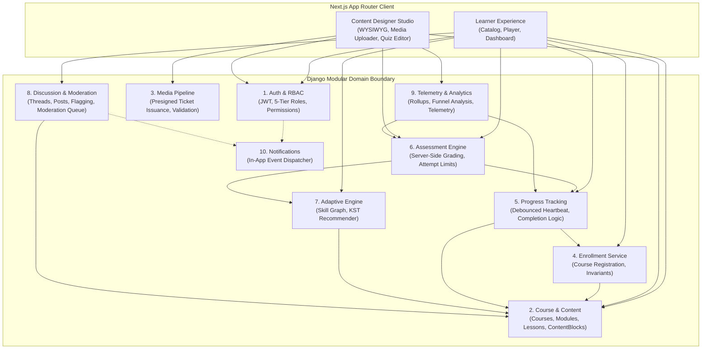

1. **Auth & RBAC Module (`apps.users`):** Authenticates users via SimpleJWT, issues rotating refresh tokens, enforces 5-tier role permissions, and records GDPR consent logs (`FR-AUTH-01`–`05`).
2. **Course & Content Management (`apps.courses`, `apps.content`):** Manages the 4-level pedagogical hierarchy (`Course` > `Module` > `Lesson` > `ContentBlock`), supporting polymorphic block types and draft/publish workflows (`FR-CRS-01`–`07`).
3. **Media Pipeline (`apps.content.media`):** Issues presigned S3 upload URLs to the browser and coordinates asynchronous Celery validation, thumbnail generation, and closed-caption ingestion (`FR-MED-01`–`05`).
4. **Enrollment Service (`apps.enrollments`):** Enforces single-enrollment invariants and initializes blank progress ledgers upon course entry (`FR-CRS-03`).
5. **Progress Tracking Engine (`apps.progress`):** Consumes debounced 10-second client playback heartbeats, updates lesson completion percent, and idempotently calculates overall course completion (`FR-TRK-01`–`04`).
6. **Assessment & Grading Engine (`apps.assessments`):** Conceals correct answer keys from browsers, validates attempt limits (`max_attempts`), computes partial credit on multi-select questions, and records atomic grades (`FR-ASM-01`–`06`).
7. **Adaptive Personalization Engine (`apps.learning`):** Implements Knowledge-Space Theory over a directed skill graph, continuously updating student mastery vectors and executing branching logic (< 70% remedial, $\ge 85\%$ advanced) (`FR-PER-01`–`05`).
8. **Discussion & Moderation (`apps.discussions`):** Contextual course/lesson forums, nested replies, offensive content flagging, and moderator queue management (`FR-DIS-01`–`05`).
9. **Telemetry & Analytics (`apps.analytics`):** Computes background rollups for instructor dashboards, identifying lesson drop-off bottlenecks and question discrimination indices (`FR-ANL-01`–`04`).
10. **Notification Dispatcher (`apps.notifications`):** Queues asynchronous in-app alerts and digest notifications for replies, grades, and enrollments (`FR-NOT-01`–`03`).

---

## 4. Formal UML Architectural Models

All UML models are maintained as version-controlled Mermaid source files in [`docs/diagrams/`](file:///c:/Users/amtul/Desktop/futurelearning_starter/docs/diagrams) and embedded below for complete traceability.

### 4.1 System Use Case Model
- **Source File:** [`docs/diagrams/use-case.mmd`](file:///c:/Users/amtul/Desktop/futurelearning_starter/docs/diagrams/use-case.mmd)
- **Description:** Depicts the interaction boundaries between the five platform actors and the core functional modules.

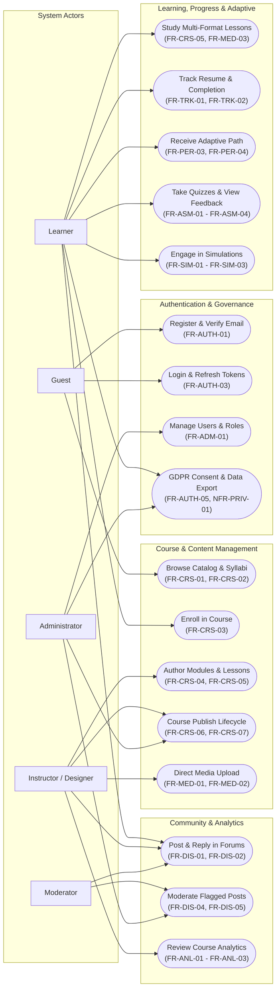

---

### 4.2 Component Architecture Model
- **Source File:** [`docs/diagrams/component-architecture.mmd`](file:///c:/Users/amtul/Desktop/futurelearning_starter/docs/diagrams/component-architecture.mmd)
- **Description:** Details internal component contracts across Presentation, Gateway, Service, Async Worker, and Data Persistence tiers.

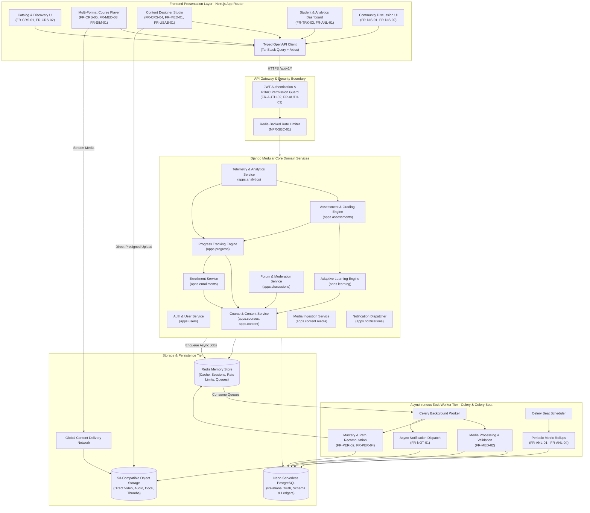

---

### 4.3 Class & Domain Model
- **Source File:** [`docs/diagrams/class-domain-model.mmd`](file:///c:/Users/amtul/Desktop/futurelearning_starter/docs/diagrams/class-domain-model.mmd)
- **Description:** Object-oriented domain model illustrating entities, field types, cardinalities, and encapsulation methods.

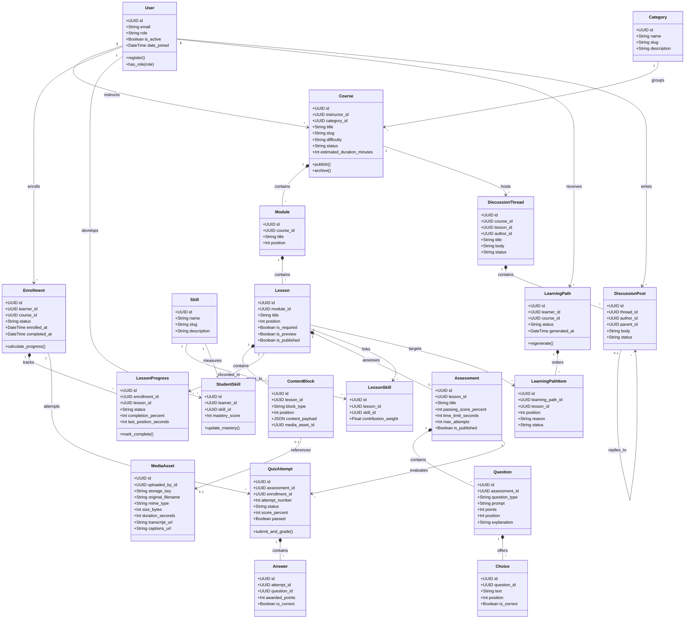

---

### 4.4 Relational Database Entity-Relationship Diagram (ERD)
- **Source File:** [`docs/diagrams/erd.mmd`](file:///c:/Users/amtul/Desktop/futurelearning_starter/docs/diagrams/erd.mmd)
- **Description:** Complete relational schema deployed to Neon PostgreSQL, showing composite unique keys, primary keys, and foreign keys.

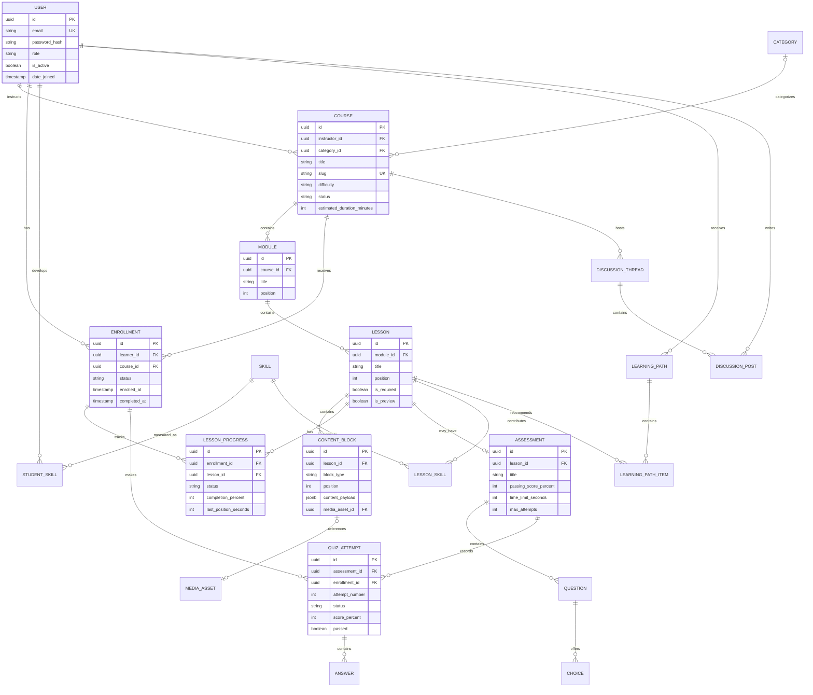

---

### 4.5 Sequence Diagrams for Key End-to-End Scenarios

#### Scenario 1: Authentication & JWT Lifecycle
- **Source File:** [`docs/diagrams/seq-login.mmd`](file:///c:/Users/amtul/Desktop/futurelearning_starter/docs/diagrams/seq-login.mmd)

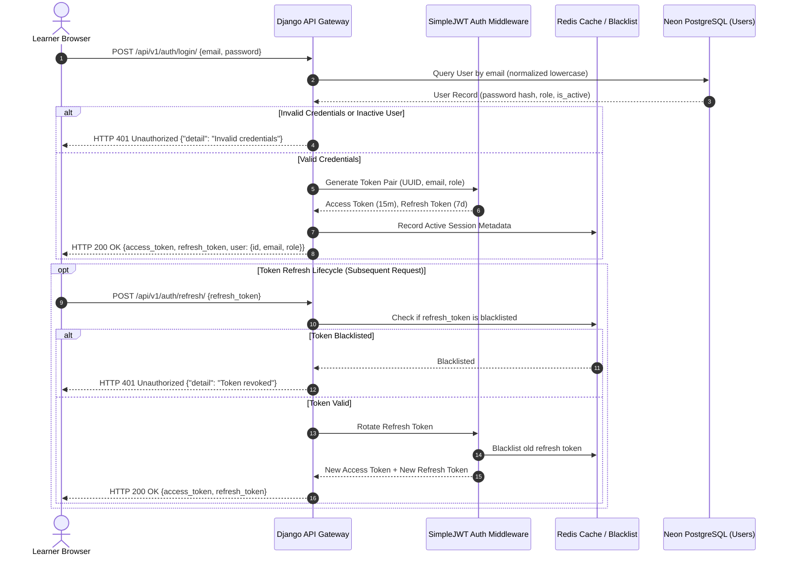

#### Scenario 2: Presigned Media Upload & Asynchronous Ingestion
- **Source File:** [`docs/diagrams/seq-upload-content.mmd`](file:///c:/Users/amtul/Desktop/futurelearning_starter/docs/diagrams/seq-upload-content.mmd)

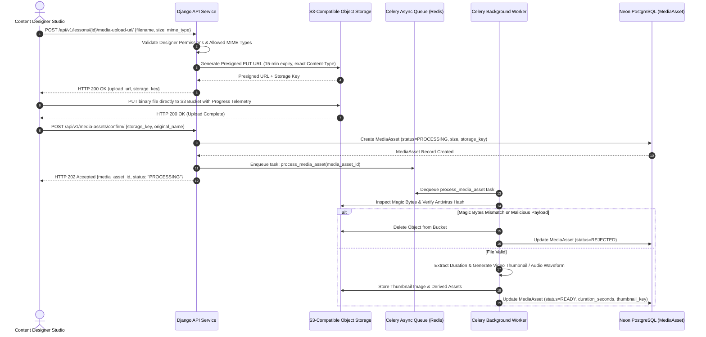

#### Scenario 3: Assessment Scoring & Adaptive Pathway Calibration
- **Source File:** [`docs/diagrams/seq-quiz-adaptive.mmd`](file:///c:/Users/amtul/Desktop/futurelearning_starter/docs/diagrams/seq-quiz-adaptive.mmd)

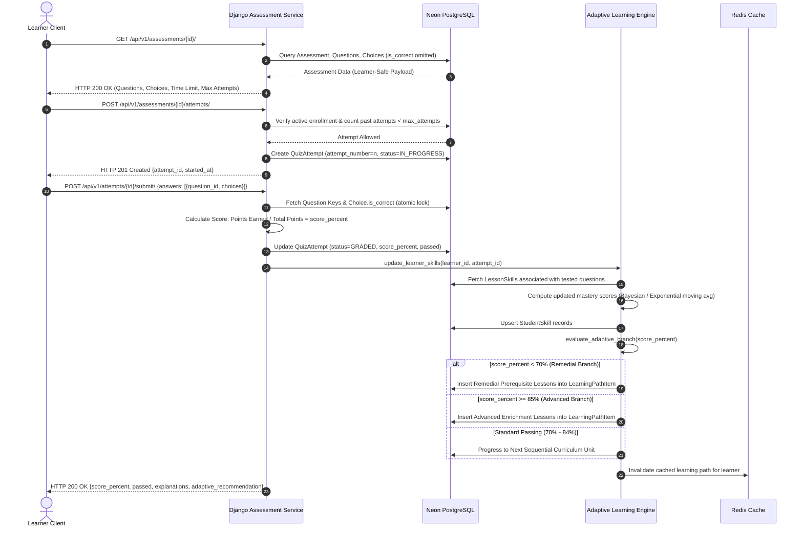

#### Scenario 4: Debounced Progress Heartbeat & Course Completion
- **Source File:** [`docs/diagrams/seq-progress-sync.mmd`](file:///c:/Users/amtul/Desktop/futurelearning_starter/docs/diagrams/seq-progress-sync.mmd)

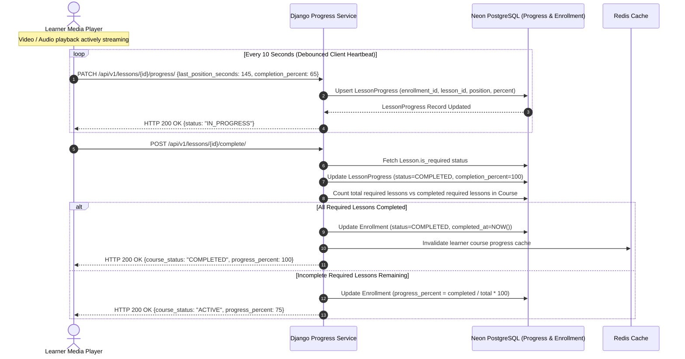

---

### 4.6 State Machine Models

#### State Machine 1: Course Authoring & Publishing Lifecycle
- **Source File:** [`docs/diagrams/state-course-publish.mmd`](file:///c:/Users/amtul/Desktop/futurelearning_starter/docs/diagrams/state-course-publish.mmd)

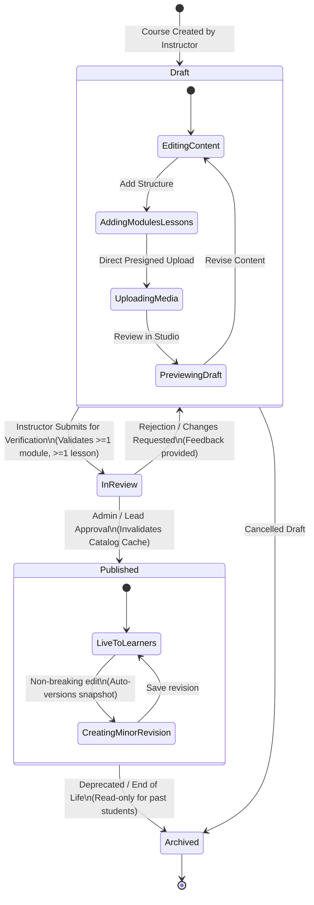

#### State Machine 2: Quiz Attempt Lifecycle
- **Source File:** [`docs/diagrams/state-quiz-attempt.mmd`](file:///c:/Users/amtul/Desktop/futurelearning_starter/docs/diagrams/state-quiz-attempt.mmd)

```mermaid
stateDiagram-v2
    [*] --> Initialized : Learner Opens Quiz Checkpoint

    Initialized --> InProgress : Start Attempt\n(Attempt count < max_attempts;\nLock timer)

    state InProgress {
        [*] --> AnsweringQuestions
        AnsweringQuestions --> UpdatingSelections : Learner selects choices
        UpdatingSelections --> AnsweringQuestions : Next Question
    }

    InProgress --> Submitted : Explicit User Submission\n(Before deadline)
    
    InProgress --> AutoSubmitted : Time Limit Expiry\n(Backend timer threshold)

    Submitted --> Graded : Server Calculates Points\n(Atomically validates answers)
    
    AutoSubmitted --> Graded : Server Grades Partial Responses

    state Graded {
        [*] --> ScoreCalculated
        ScoreCalculated --> Passed : score >= passing_score_percent\n(Triggers Mastery Update)
        ScoreCalculated --> Failed : score < passing_score_percent\n(Triggers Remedial Branch)
    }

    Passed --> Completed : High Score Recorded
    
    Failed --> Completed : Max Attempts Reached
    
    Failed --> InProgress : Retake Attempt\n(Attempt count < max_attempts)

    Completed --> [*]
```

---

### 4.7 Production Deployment Topology
- **Source File:** [`docs/diagrams/deployment.mmd`](file:///c:/Users/amtul/Desktop/futurelearning_starter/docs/diagrams/deployment.mmd)

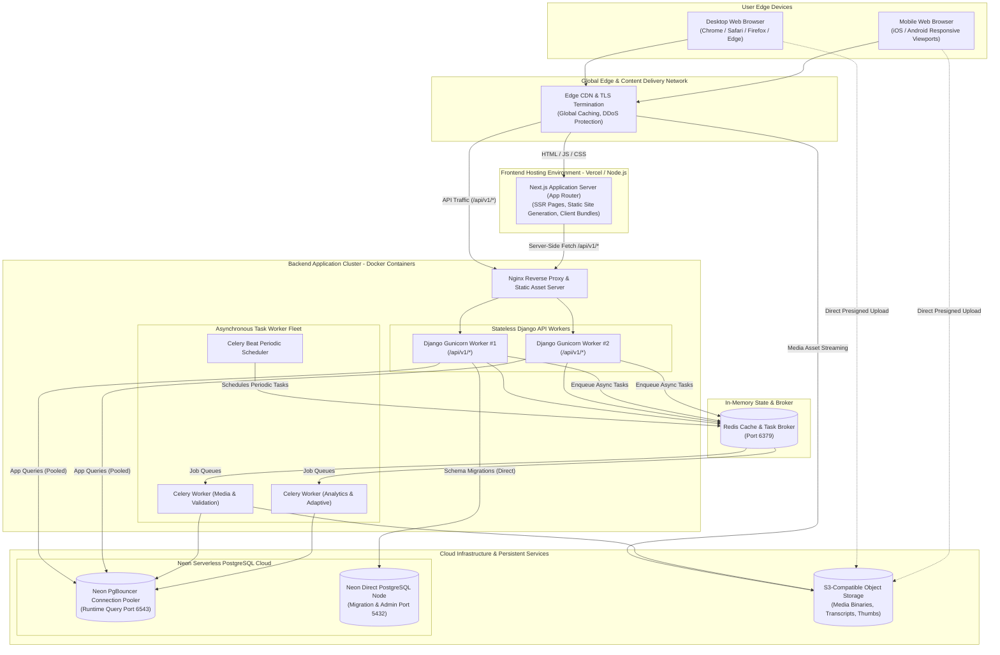

---

## 5. Abstract Models & Adaptive Innovation (Rubric C2)

### 5.1 Innovation Rationale: Knowledge-Space Adaptive Personalization
Traditional online learning management systems enforce rigid, monolithic curricula where all students must traverse identical linear content sequences regardless of prior competency or learning velocity. In contrast, the **FutureLearning Adaptive Engine** implements a mathematically rigorous **Knowledge-Space Theory (KST)** model ([`D-008`](file:///c:/Users/amtul/Desktop/futurelearning_starter/docs/decision.md#d-008-knowledge-space-skill-graph-and-pluggable-adaptive-engine)). 

The architecture models knowledge as an abstract **Directed Acyclic Graph (DAG)** of atomic competencies ($\mathcal{S}$), associating instructional content and assessment items with weighted skill vectors.

```text
       [Skill S1: Basic Syntax]
                  |
                  v
       [Skill S2: Data Structures]
         /                     \
        v                       v
[Skill S3: Recursion]    [Skill S4: Search Algorithms]
        \                       /
         v                     v
       [Skill S5: Dynamic Programming]
```

### 5.2 Mathematical Formalization of the Learner Model
1. **Skill Space:** Let $\mathcal{S} = \{s_1, s_2, \dots, s_N\}$ be the finite set of academic skills within a course domain.
2. **Prerequisite Partial Order:** Let $\prec$ denote the strict partial order of prerequisites over $\mathcal{S}$, where $s_i \prec s_j$ signifies that mastery of $s_i$ is a mandatory pedagogical prerequisite for studying $s_j$.
3. **Learner Mastery State Vector:** For any learner $u$, their mastery state is represented as a real-valued vector:
   $$\mathbf{M}_u = \big(m(u, s_1), m(u, s_2), \dots, m(u, s_N)\big) \quad \text{where } m(u, s_i) \in [0.0, 1.0]$$
4. **Assessment Skill Mapping:** Each assessment question $q$ is linked to a target skill $s(q)$ with an item discrimination weight $w_q \in (0.0, 1.0]$.
5. **Mastery Updating Algorithm:** When learner $u$ completes assessment attempt $a$, their skill mastery score is updated using an Exponentially Weighted Moving Average (EWMA):
   $$m_{t+1}(u, s) = (1 - \alpha) \cdot m_t(u, s) + \alpha \cdot \left(\frac{\sum_{q \in Q_s} \text{awarded\_points}(q)}{\sum_{q \in Q_s} \text{max\_points}(q)}\right)$$
   Where $\alpha = 0.35$ is the empirical learning sensitivity coefficient.

### 5.3 Pluggable Strategy Pattern Architecture
To decouple mathematical heuristic rules from business controllers, the engine is encapsulated behind a strict strategy interface:

```python
# backend/apps/learning/strategies/base.py
from abc import ABC, abstractmethod
from typing import List
from apps.users.models import User
from apps.courses.models import Course, Lesson

class RecommendationItem:
    def __init__(self, lesson: Lesson, reason: str, is_remedial: bool):
        self.lesson = lesson
        self.reason = reason
        self.is_remedial = is_remedial

class AdaptiveStrategy(ABC):
    @abstractmethod
    def evaluate_mastery(self, user: User, attempt_id: str) -> None:
        """Update learner skill mastery vector upon quiz attempt submission."""
        pass

    @abstractmethod
    def generate_recommendations(self, user: User, course: Course) -> List[RecommendationItem]:
        """Generate ordered list of next, remedial, or enrichment lessons."""
        pass
```

- **Default Implementation (`RuleBasedAdaptiveStrategy`):**
  - **Remedial Trigger ($m(u, s) < 0.70$):** Identifies the lowest-scoring unmastered skill $s_{fail}$, traverses the DAG backward to find unmastered prerequisite lessons, and injects them as high-priority remedial units with transparent justification (*"Recommended because your score on 'Recursion' was 58%"*).
  - **Enrichment Trigger ($m(u, s) \ge 0.85$):** Unlocks advanced elective lessons associated with child nodes in the skill graph, challenging high-performing learners.
- **Future ML Capability:** Enables data science teams to drop in reinforcement learning (e.g., Deep Q-Networks) or collaborative filtering models in Phase 11 without refactoring database models or client API contracts.

---

## 6. Content Model & Non-Technical Authoring

### 6.1 Composite ContentBlock Architecture
To satisfy the core requirement that non-technical content designers can build and update diverse media without programming (`FR-CRS-04`, `FR-CRS-05`, `NFR-USAB-01`), lessons are composed of ordered, polymorphic `ContentBlock` instances ([`D-009`](file:///c:/Users/amtul/Desktop/futurelearning_starter/docs/decision.md#d-009-composite-contentblock-architecture-and-draftpublish-versioning)):

```text
Course (Metadata, Slug, Category, Difficulty, Status)
  └── Module (Title, Description, Position)
        └── Lesson (Title, Duration, is_required, is_preview)
              ├── ContentBlock #1: Rich Text / Markdown
              ├── ContentBlock #2: Media Asset (Video with synchronized VTT captions)
              ├── ContentBlock #3: Interactive Simulation (Sandboxed iframe)
              └── ContentBlock #4: Formative Quiz (Assessment Checkpoint)
```

### 6.2 Safe Draft / Publish Versioning Workflow
Modifying a live course without breaking enrolled students' progress represents a severe risk in e-learning platforms. The platform implements a **Copy-on-Write Versioning Protocol**:
1. When an instructor edits a `PUBLISHED` course, the system creates a draft revision snapshot.
2. Active learners continue reading published versions from the cached CDN and Redis layers without disruption.
3. Once the instructor finishes editing and validates prerequisites, clicking **Publish**:
   - Updates `Course.status = PUBLISHED` and increments `version_number`.
   - Atomically updates lesson block relationships.
   - Dispatches a Redis cache invalidation event across `fl:crs:{id}:*` keys.

---

## 7. Caching & Performance Architecture (NFR-PERF-01)

### 7.1 Multi-Layer Redis Caching Strategy
To achieve the strict target of **$p95 < 300\text{ ms}$** read latency under 10,000 concurrent active users, Redis is deployed as a high-speed cache-aside layer ([`D-010`](file:///c:/Users/amtul/Desktop/futurelearning_starter/docs/decision.md#d-010-multi-layer-redis-caching-and-event-invalidation-protocol)):

| Cache Key Pattern | Cached Data Payload | TTL | Invalidation Event / Trigger |
|---|---|---|---|
| `fl:cat:list` | Serialized top-level category taxonomy | 24 Hours | Category creation / update in `apps.courses` |
| `fl:crs:public:catalog` | Paginated published course catalog with filters | 15 Minutes | Course publication, title edit, or category change |
| `fl:crs:{slug}:detail` | Full course metadata, module list, public syllabus | 1 Hour | Course/Module/Lesson CRUD or publish action |
| `fl:user:{id}:profile` | User identity, role, active enrollments list | 30 Minutes | Profile update, role assignment, or new enrollment |
| `fl:user:{id}:progress:{crs_id}` | Learner completed lesson IDs and overall progress % | 10 Minutes | Lesson completion event or progress reset |
| `fl:throttle:{ip}:{endpoint}` | Sliding-window request counter for rate limiting | 60 Seconds | Automated Redis TTL expiry |

---

## 8. Asynchronous Task Worker Fleet (Celery Catalogue)

All background workloads are catalogued and assigned to dedicated Redis message queues:

| Task Function Name | Target Queue | Trigger Event | Retry Policy | Timeout |
|---|---|---|---|---|
| `content.tasks.validate_media_asset` | `media` | Direct upload confirmation (`POST /media-assets/confirm/`) | 3 retries, exponential backoff (10s, 30s, 90s) | 300s |
| `content.tasks.generate_video_thumbnails` | `media` | Successful video validation | 2 retries | 600s |
| `learning.tasks.recompute_learner_mastery` | `adaptive` | Quiz attempt submission or simulation score report | 3 retries, 5s delay | 60s |
| `learning.tasks.generate_adaptive_path` | `adaptive` | Student mastery update or on-demand path regeneration | 2 retries | 120s |
| `notifications.tasks.dispatch_event_alert` | `notifications` | Forum reply, quiz grade release, announcement | 5 retries | 30s |
| `analytics.tasks.aggregate_hourly_rollups` | `analytics` | Celery Beat periodic schedule (`0 * * * *`) | No retry (runs next cycle) | 900s |
| `users.tasks.export_user_data_archive` | `default` | User GDPR export request (`POST /me/export/`) | 2 retries | 300s |

---

## 9. Security, Privacy & Compliance Architecture

```text
+-------------------------------------------------------------------------------------------------+
|                                 DEFENSE-IN-DEPTH SECURITY MODEL                                 |
+--------------------------+------------------------------+---------------------------------------+
|   AUTHENTICATION & RBAC  |      DATA PROTECTION         |         APPLICATION HARDENING         |
| SimpleJWT Access (15m)   | HTTPS / TLS 1.3 Strict       | Strict CSP & Frame Sandboxing         |
| Rotating Refresh (7d)    | Passwords: PBKDF2 SHA-256    | Redis Rate Limiting (100 req/min)     |
| 5-Tier Server Guard      | GDPR Export & Erasure Logic  | Zero Raw SQL; ORM Parameterization   |
+--------------------------+------------------------------+---------------------------------------+
```

1. **Authentication & Token Rotation (`FR-AUTH-03`):** Access tokens expire in 15 minutes. Refresh tokens rotate on every invocation; previously used refresh tokens are blacklisted immediately in Redis.
2. **Access Control Matrix (`FR-AUTH-02`, `D-006`):**
   - `Guest`: Read public catalog (`GET /courses/`), read preview lessons.
   - `Learner`: Write enrollments (`POST /courses/{id}/enroll/`), write progress, submit quizzes.
   - `Instructor`: Full CRUD on owned courses, modules, lessons, assessments, and analytics.
   - `Moderator`: Manage reported forum posts (`POST /discussions/{id}/moderate/`).
   - `Administrator`: Global user role assignment, category CRUD, system configuration.
3. **Question Key Protection (`FR-ASM-02`):** `Choice.is_correct` is excluded from DRF serializer contexts for learner requests, making client-side answer sniffing physically impossible.
4. **GDPR Data Portability & Erasure (`FR-AUTH-05`, `NFR-PRIV-01`):**
   - Data export generates an encrypted, machine-readable JSON archive containing user profile, enrollments, quiz attempts, and forum posts.
   - Account erasure anonymizes student records (`email = "deleted_user_{uuid}@deleted.futurelearning.org"`, `first_name = "Deleted"`, `last_name = "User"`), scrubbing PII while preserving historical course aggregate counts.

---

## 10. Scalability & High-Load Architecture (NFR-SCAL-01)

1. **Stateless Web API Layer:** All session state resides in signed JWTs or Redis. Django application containers can scale horizontally across $N$ replicas behind Nginx.
2. **Neon Connection Management:**
   - **Runtime Queries:** Application workers connect to Neon via **PgBouncer** connection pooling (`ep-ancient-wildflower-b3hehj34-pooler.c-4.ap-southeast-1.aws.neon.tech`), maintaining persistent connection pools with `conn_max_age=60` and `conn_health_checks=True`.
   - **Migrations & DDL:** Django management commands (`python manage.py migrate`) utilize the direct PostgreSQL connection (`port 5432`) to prevent pooler lockups.
3. **Direct S3 Binary Uploads:** Large media files never transit Django web worker memory, eliminating worker thread exhaustion during high concurrency.
4. **Database Query Indexing:**
   - Composite index on `Course (status, category_id)` for sub-50ms catalog filtering.
   - Unique composite index on `Enrollment (learner_id, course_id)` for single-enrollment guarantee.
   - Unique composite index on `LessonProgress (enrollment_id, lesson_id)` for idempotent progress upserts.
   - Composite index on `QuizAttempt (enrollment_id, assessment_id, attempt_number)` for fast attempt counting.

---

## 11. Requirements-to-Component Traceability Matrix

| Requirement ID | Module / Component | Primary Model / Class | API Endpoint / Service File |
|---|---|---|---|
| `FR-AUTH-01` | Auth & User | `apps.users.models.User` | `POST /api/v1/auth/register/` |
| `FR-AUTH-02` | Auth & User | `apps.users.permissions.IsRole` | `backend/apps/users/permissions.py` |
| `FR-AUTH-03` | Auth & User | `rest_framework_simplejwt` | `POST /api/v1/auth/login/`, `/token/refresh/` |
| `FR-AUTH-04` | Auth & User | `apps.users.services.PasswordReset` | `POST /api/v1/auth/password-reset/` |
| `FR-AUTH-05` | Auth & User | `apps.users.models.UserConsent` | `backend/apps/users/models.py` |
| `FR-CRS-01` | Course | `apps.courses.models.Course` | `GET /api/v1/courses/` |
| `FR-CRS-02` | Course | `apps.courses.models.Course` | `GET /api/v1/courses/{id}/` |
| `FR-CRS-03` | Enrollment | `apps.enrollments.models.Enrollment` | `POST /api/v1/courses/{id}/enroll/` |
| `FR-CRS-04` | Course / Content | `Module`, `Lesson` | `backend/apps/content/models.py` |
| `FR-CRS-05` | Content | `apps.content.models.ContentBlock` | `backend/apps/content/models.py` |
| `FR-CRS-06` | Course | `apps.courses.services.PublishService` | `POST /api/v1/courses/{id}/publish/` |
| `FR-CRS-07` | Course | `apps.courses.models.CourseVersion` | `backend/apps/courses/models.py` |
| `FR-MED-01` | Media | `apps.content.models.MediaAsset` | `POST /api/v1/lessons/{id}/media-upload-url/` |
| `FR-MED-02` | Media | `apps.content.tasks.validate_media` | `backend/apps/content/tasks.py` |
| `FR-MED-03` | Media / Player | `MediaAsset.captions_url` | `frontend/src/components/player/MediaPlayer.tsx` |
| `FR-PER-01` | Adaptive Learning | `Skill`, `LessonSkill` | `backend/apps/learning/models.py` |
| `FR-PER-02` | Adaptive Learning | `apps.learning.models.StudentSkill` | `backend/apps/learning/services/mastery.py` |
| `FR-PER-03` | Adaptive Learning | `apps.learning.strategies.RuleBased`| `backend/apps/learning/strategies/` |
| `FR-PER-04` | Adaptive Learning | `LearningPath`, `LearningPathItem` | `GET /api/v1/me/learning-path/` |
| `FR-PER-05` | Adaptive Learning | `AdaptiveStrategy` Interface | `backend/apps/learning/strategies/base.py` |
| `FR-TRK-01` | Progress | `apps.progress.models.LessonProgress`| `PATCH /api/v1/lessons/{id}/progress/` |
| `FR-TRK-02` | Progress / Enroll | `apps.progress.services.Completion` | `POST /api/v1/lessons/{id}/complete/` |
| `FR-TRK-03` | Progress / UI | `LearnerDashboardView` | `frontend/src/app/dashboard/page.tsx` |
| `FR-ASM-01` | Assessment | `Assessment`, `Question`, `Choice` | `POST /api/v1/lessons/{id}/assessment/` |
| `FR-ASM-02` | Assessment | `apps.assessments.services.Grader` | `POST /api/v1/attempts/{id}/submit/` |
| `FR-ASM-03` | Assessment | `QuizAttempt.attempt_number` | `backend/apps/assessments/models.py` |
| `FR-ASM-04` | Assessment | `apps.assessments.serializers` | `GET /api/v1/attempts/{id}/result/` |
| `FR-SIM-01` | Simulation | `SimulationBlock` | `frontend/src/components/player/SimulationFrame.tsx` |
| `FR-SIM-02` | Simulation | `postMessage` Handshake Contract | `frontend/src/lib/simulationProtocol.ts` |
| `FR-SIM-03` | Simulation / Prog | `apps.progress.services.SimScore` | `POST /api/v1/lessons/{id}/sim-score/` |
| `FR-DIS-01` | Discussion | `apps.discussions.models.Thread` | `GET/POST /api/v1/courses/{id}/discussions/` |
| `FR-DIS-02` | Discussion | `apps.discussions.models.Post` | `POST /api/v1/discussions/{id}/posts/` |
| `FR-DIS-04` | Discussion | `apps.discussions.models.Report` | `POST /api/v1/discussions/{id}/report/` |
| `FR-DIS-05` | Discussion / Mod | `apps.discussions.services.ModQueue` | `POST /api/v1/discussions/{id}/moderate/` |
| `FR-ANL-01` | Analytics | `apps.analytics.models.CourseRollup` | `GET /api/v1/courses/{id}/analytics/` |
| `FR-ADM-01` | Administration | `apps.users.views.AdminUserViewSet` | `GET/PATCH /api/v1/admin/users/` |
| `FR-ADM-02` | Administration | `apps.courses.models.Category` | `GET/POST /api/v1/categories/` |
| `NFR-PERF-01`| Performance / Cache| Redis Cache-Aside & Connection Pool| `backend/config/settings.py` |
| `NFR-SCAL-01`| Scalability / Infra| Docker Compose Stateless Replicas | `infra/docker-compose.yml` |
| `NFR-A11Y-01`| Accessibility | Next.js Accessible Design Primitives| `frontend/src/components/ui/*` |
| `NFR-USAB-01`| Authoring Usability| Content Designer Studio WYSIWYG | `frontend/src/app/studio/page.tsx` |
| `NFR-PRIV-01`| Privacy / GDPR | `users.tasks.export_user_data` | `POST /api/v1/me/export/` |
