# FutureLearning Comprehensive Project Plan (PERT / CPM)
**Document Identifier:** `DOC-PLAN-004`  
**Standard Compliance:** Project Management Body of Knowledge (PMBOK® Guide) / IEEE 1058 Standard for Software Project Management Plans  
**Revision:** 1.0 (Phase 10 Baseline)  
**Academic Context:** Complex Computing Problem (CCP) - University Software Engineering  
**Project Parameters:** 4-Person Engineering Team | 12-Week Academic Semester (60 Business Days)  
**Analytical Engine:** Reproducible Python Model in [`docs/scripts/pert_cpm.py`](file:///c:/Users/amtul/Desktop/futurelearning_starter/docs/scripts/pert_cpm.py)  

---

## 1. Executive Summary & Project Parameters

### 1.1 Project Objective
The **FutureLearning Learning Engine** is an enterprise-grade, accessible, and adaptive learning platform designed to fulfill the University Software Engineering Complex Computing Problem (CCP). The engineering schedule spans from inception to final accredited handover across a 12-week academic semester (60 business days).

### 1.2 Team Structure & Resource Allocation
In accordance with [`D-004`](file:///c:/Users/amtul/Desktop/futurelearning_starter/docs/decision.md#d-004-user-scope-clarifications-and-operational-parameters), the platform was engineered by a balanced 4-person software engineering team:
1. **Engineer 1 (Lead Systems Architect & Tech Lead):** Overall system design, domain invariants, Knowledge-Space Theory (KST) adaptive graph algorithms, code review, and final packaging.
2. **Engineer 2 (Backend & Database Specialist):** Django REST Framework API ViewSets, Neon PostgreSQL data modeling, Redis caching layers, and Celery asynchronous task fleets.
3. **Engineer 3 (Frontend & Universal Accessibility Specialist):** Next.js App Router client architecture, Tailwind CSS design system, WCAG 2.1 AA keyboard/screen reader compliance, and sandboxed simulation runner.
4. **Engineer 4 (QA, Security & DevOps Specialist):** IEEE 829 test plan, automated Pytest suite, Locust load testing harness, OWASP Top 10 defense-in-depth hardening, and Neon point-in-time recovery.

### 1.3 Cost & Budget Constraints
- **Infrastructure Budget:** \$0.00 direct operational cost during development, achieved via serverless free-tier allocations:
  - Neon Serverless PostgreSQL (0.5 compute units, 3GB storage free tier).
  - Upstash / Local Redis for caching and Celery task brokering.
  - S3-compatible local/cloud bucket storage for media binaries.
- **Labor Constraint:** 4 engineers &times; 20 hours/week &times; 12 weeks = 960 person-hours total project effort budget.

---

## 2. Work Breakdown Structure (WBS)

The project work breakdown decomposes the entire engineering lifecycle into 16 discrete, manageable work packages:

```text
WBS 1.0: Requirements Engineering & Scope Freeze (Activity A)
WBS 2.0: System Architecture, ERD & API Specification (Activity B)
WBS 3.0: Infrastructure, Neon DB, Redis & Celery Scaffolding (Activity C)
WBS 4.0: Identity, RBAC, SimpleJWT & GDPR Consent (Activity D)
WBS 5.0: Course, Module, Lesson Hierarchy & Content Blocks (Activity E)
WBS 6.0: Public Catalog, Preview & Idempotent Enrollment (Activity F)
WBS 7.0: Progress Heartbeats, Telemetry Stream & Completion (Activity G)
WBS 8.0: Assessment Engine (Quizzes, Grading, Attempt Limits) (Activity H)
WBS 9.0: Adaptive Learning Engine (KST Skill DAG & Remediation) (Activity I)
WBS 10.0: Discussion Forums, Upvotes, Endorsements & Moderation (Activity J)
WBS 11.0: Sandboxed Interactive Simulations (postMessage) (Activity K)
WBS 12.0: Analytics Dashboards, Daily Celery Rollups & GDPR Rights (Activity L)
WBS 13.0: Security Hardening, DRF Rate Throttles & WCAG A11y (Activity M)
WBS 14.0: Comprehensive Test Suite (E2E Journey, Locust Load) (Activity N)
WBS 15.0: Deployment Validation & Database Disaster Recovery (Activity O)
WBS 16.0: Validation Report, Package Compilation & Handover (Activity P)
```

---

## 3. PERT Statistical Estimation & Distribution Analysis

Program Evaluation and Review Technique (PERT) models duration uncertainty by calculating the weighted expected duration ($T_e$) and variance ($\sigma^2$) from three-point estimates:
- **Optimistic Time ($a$):** Best-case duration assuming zero blocking defects and seamless integration.
- **Most Likely Time ($m$):** Realistic duration under typical working conditions.
- **Pessimistic Time ($b$):** Worst-case duration accounting for technical blockers, debugging, or rework.

$$\text{Expected Duration } T_e = \frac{a + 4m + b}{6}, \quad \text{Variance } \sigma^2 = \left(\frac{b - a}{6}\right)^2, \quad \text{Std Dev } \sigma = \frac{b - a}{6}$$

### 3.1 PERT Estimation Table (All Times in Business Days)

| ID | WBS | Activity Name | $a$ | $m$ | $b$ | $T_e$ | Variance ($\sigma^2$) | Std Dev ($\sigma$) | Assigned Lead | Core Deliverable |
|---|---|---|---|---|---|---|---|---|---|---|
| **A** | 1.0 | Requirements Engineering & Scope Freeze | 2.0 | 3.0 | 5.0 | **3.17** | 0.2500 | 0.500 | Lead Architect | `docs/01-requirements.md` (47 FRs, 12 NFRs) |
| **B** | 2.0 | System Architecture, ERD & API Contract | 3.0 | 4.0 | 7.0 | **4.33** | 0.4444 | 0.667 | Lead Architect | `docs/02-system-design.md`, `docs/diagrams/` |
| **C** | 3.0 | Infra, Neon DB, Redis & Celery Scaffolding | 2.0 | 3.0 | 4.0 | **3.00** | 0.1111 | 0.333 | DevOps / Backend | `infra/docker-compose.yml`, Neon pool |
| **D** | 4.0 | Identity, RBAC, SimpleJWT & GDPR Consent | 3.0 | 4.0 | 6.0 | **4.17** | 0.2500 | 0.500 | Backend Engineer | `apps/users`, SimpleJWT, 5-tier role model |
| **E** | 5.0 | Course Hierarchy & Content Block Authoring | 4.0 | 5.0 | 8.0 | **5.33** | 0.4444 | 0.667 | Fullstack Team | `apps/courses`, `apps/content`, Studio UI |
| **F** | 6.0 | Public Catalog & Idempotent Enrollment | 3.0 | 4.0 | 5.0 | **4.00** | 0.1111 | 0.333 | Fullstack Engineer | `/courses` catalog, atomic enrollment API |
| **G** | 7.0 | Progress Heartbeats & Telemetry Stream | 3.0 | 4.0 | 6.0 | **4.17** | 0.2500 | 0.500 | Backend Engineer | `apps/progress`, `LearningEvent` audit stream |
| **H** | 8.0 | Assessment Engine (Quizzes, Grading, Limits)| 4.0 | 5.0 | 7.0 | **5.17** | 0.2500 | 0.500 | Backend / QA | `apps/assessments`, server-side grader |
| **I** | 9.0 | Adaptive Engine (KST Skill DAG & Branching)| 4.0 | 5.0 | 8.0 | **5.33** | 0.4444 | 0.667 | Lead Architect | `apps/learning`, `KnowledgeSpaceStrategy` |
| **J** | 10.0| Discussions, Upvotes & Moderation Queue | 3.0 | 4.0 | 6.0 | **4.17** | 0.2500 | 0.500 | Fullstack Engineer | `apps/discussions`, moderation triage |
| **K** | 11.0| Sandboxed Interactive Simulations | 2.0 | 3.0 | 5.0 | **3.17** | 0.2500 | 0.500 | Frontend Engineer | `SimulationRunner.tsx`, `postMessage` contract |
| **L** | 12.0| Analytics Dashboards & Celery Rollups | 3.0 | 4.0 | 6.0 | **4.17** | 0.2500 | 0.500 | Backend / Frontend | `apps/analytics`, `/studio/analytics`, `/admin` |
| **M** | 13.0| Security Hardening & WCAG A11y Audit | 3.0 | 4.0 | 6.0 | **4.17** | 0.2500 | 0.500 | Security / DevOps | CSP, DRF throttles, WCAG 2.1 AA audit |
| **N** | 14.0| Comprehensive Testing (E2E & Load Harness)| 3.0 | 4.0 | 5.0 | **4.00** | 0.1111 | 0.333 | QA Engineer | `docs/03-test-plan.md`, `test_e2e_journey.py` |
| **O** | 15.0| Deployment & Database Disaster Recovery | 2.0 | 3.0 | 5.0 | **3.17** | 0.2500 | 0.500 | DevOps / Lead | Neon PITR restore, production Docker build |
| **P** | 16.0| Validation Report & Handover Compilation | 2.0 | 3.0 | 5.0 | **3.17** | 0.2500 | 0.500 | Entire Team (4) | `docs/05-validation.md`, root README, demo |

---

## 4. Critical Path Method (CPM) Forward & Backward Pass Analysis

The Critical Path Method (CPM) computes the deterministic project schedule, identifies early/late milestones, and exposes available float (slack) for non-critical activities.

### 4.1 Forward Pass (Earliest Times)
- **Early Start (ES):** $\text{ES}_i = \max_{p \in \text{Pred}(i)} (\text{EF}_p)$, with $\text{ES}_A = 0.00$.
- **Early Finish (EF):** $\text{EF}_i = \text{ES}_i + T_{e, i}$.
- **Total Project Duration:** $T_{\text{proj}} = \max_i (\text{EF}_i) = \mathbf{49.01\text{ business days}}$.

### 4.2 Backward Pass (Latest Times)
- **Late Finish (LF):** $\text{LF}_i = \min_{s \in \text{Succ}(i)} (\text{LS}_s)$, with $\text{LF}_P = T_{\text{proj}} = 49.01$.
- **Late Start (LS):** $\text{LS}_i = \text{LF}_i - T_{e, i}$.

### 4.3 Float (Slack) Calculations
- **Total Float (TF):** $\text{TF}_i = \text{LS}_i - \text{ES}_i = \text{LF}_i - \text{EF}_i$. Indicates maximum days an activity can be delayed without delaying the final project completion date.
- **Free Float (FF):** $\text{FF}_i = \min_{s \in \text{Succ}(i)} (\text{ES}_s) - \text{EF}_i$. Indicates days an activity can be delayed without delaying the early start of any immediate successor.
- **Critical Activity Invariant:** An activity is critical if and only if $\text{TF}_i = 0.00$.

### 4.4 Comprehensive CPM Schedule Table

| ID | WBS | Activity Name | $T_e$ (d) | Predecessors | ES (d) | EF (d) | LS (d) | LF (d) | Total Float (TF) | Free Float (FF) | Critical? |
|:--:|:---:|---|:---:|:---:|:---:|:---:|:---:|:---:|:---:|:---:|:---:|
| **A** | 1.0 | Requirements Engineering & Scope Freeze | 3.17 | — | 0.00 | 3.17 | 0.00 | 3.17 | **0.00** | 0.00 | **YES** |
| **B** | 2.0 | System Architecture, ERD & API Contract | 4.33 | A | 3.17 | 7.50 | 3.17 | 7.50 | **0.00** | 0.00 | **YES** |
| **C** | 3.0 | Infra, Neon DB, Redis & Celery Scaffolding | 3.00 | B | 7.50 | 10.50 | 7.50 | 10.50 | **0.00** | 0.00 | **YES** |
| **D** | 4.0 | Identity, RBAC, SimpleJWT & GDPR Consent | 4.17 | C | 10.50 | 14.67 | 10.50 | 14.67 | **0.00** | 0.00 | **YES** |
| **E** | 5.0 | Course Hierarchy & Content Block Authoring | 5.33 | D | 14.67 | 20.00 | 14.67 | 20.00 | **0.00** | 0.00 | **YES** |
| **F** | 6.0 | Public Catalog & Idempotent Enrollment | 4.00 | D, E | 20.00 | 24.00 | 20.00 | 24.00 | **0.00** | 0.00 | **YES** |
| **G** | 7.0 | Progress Heartbeats & Telemetry Stream | 4.17 | F | 24.00 | 28.17 | 25.00 | 29.17 | **1.00** | 0.00 | NO |
| **H** | 8.0 | Assessment Engine (Quizzes, Grading, Limits)| 5.17 | E, F | 24.00 | 29.17 | 24.00 | 29.17 | **0.00** | 0.00 | **YES** |
| **I** | 9.0 | Adaptive Engine (KST Skill DAG & Branching)| 5.33 | G, H | 29.17 | 34.50 | 29.17 | 34.50 | **0.00** | 0.00 | **YES** |
| **J** | 10.0| Discussions, Upvotes & Moderation Queue | 4.17 | D, F | 24.00 | 28.17 | 26.16 | 30.33 | **2.16** | 1.00 | NO |
| **K** | 11.0| Sandboxed Interactive Simulations | 3.17 | E, G | 28.17 | 31.34 | 31.33 | 34.50 | **3.16** | 3.16 | NO |
| **L** | 12.0| Analytics Dashboards & Celery Rollups | 4.17 | G, H, J | 29.17 | 33.34 | 30.33 | 34.50 | **1.16** | 1.16 | NO |
| **M** | 13.0| Security Hardening & WCAG A11y Audit | 4.17 | I, K, L | 34.50 | 38.67 | 34.50 | 38.67 | **0.00** | 0.00 | **YES** |
| **N** | 14.0| Comprehensive Testing (E2E & Load Harness)| 4.00 | M | 38.67 | 42.67 | 38.67 | 42.67 | **0.00** | 0.00 | **YES** |
| **O** | 15.0| Deployment & Database Disaster Recovery | 3.17 | N | 42.67 | 45.84 | 42.67 | 45.84 | **0.00** | 0.00 | **YES** |
| **P** | 16.0| Validation Report & Handover Compilation | 3.17 | O | 45.84 | 49.01 | 45.84 | 49.01 | **0.00** | 0.00 | **YES** |

---

## 5. Critical Path & Float Interpretation

### 5.1 The Critical Path Sequence
The analytical engine identifies the unique longest path through the network where $\text{Total Float} = 0$:

$$\mathbf{A \longrightarrow B \longrightarrow C \longrightarrow D \longrightarrow E \longrightarrow F \longrightarrow H \longrightarrow I \longrightarrow M \longrightarrow N \longrightarrow O \longrightarrow P}$$

- **Total Critical Path Duration:** $\mathbf{49.01\text{ business days}}$ (9.8 calendar weeks).
- **Critical Path Interpretation:** Any delay in requirements confirmation (A), schema design (B), infrastructure scaffolding (C), authentication (D), course authoring (E), enrollment (F), assessment scoring (H), adaptive learning (I), security hardening (M), integration testing (N), disaster recovery validation (O), or final report compilation (P) will directly delay the final platform completion date day-for-day.

### 5.2 Parallel Float Channels (Buffer & Resource Flexibility)
1. **Activity G (Progress Tracking & Heartbeats):** $\text{TF} = 1.00\text{ day}$. Can absorb 1 day of delay because Activity H (Assessment Engine) takes 5.17 days compared to G's 4.17 days before converging at Activity I.
2. **Activity J (Discussion Forums & Moderation):** $\text{TF} = 2.16\text{ days}, \text{FF} = 1.00\text{ day}$. Discussions develop independently in parallel with the core assessment and adaptive engines.
3. **Activity K (Sandboxed Interactive Simulations):** $\text{TF} = 3.16\text{ days}, \text{FF} = 3.16\text{ days}$. Simulation widget development possesses significant schedule slack and does not throttle the critical path.
4. **Activity L (Analytics Dashboards & Periodic Rollups):** $\text{TF} = 1.16\text{ days}, \text{FF} = 1.16\text{ days}$. Aggregation rollups can proceed in parallel with adaptive path algorithm refinement.

---

## 6. PERT Statistical Uncertainty & Completion Probability

Under the Central Limit Theorem, the total project duration distribution approaches a normal distribution $N(\mu_{CP}, \sigma^2_{CP})$:

$$\mu_{CP} = \sum_{i \in CP} T_{e, i} = \mathbf{49.01\text{ business days}}$$
$$\sigma^2_{CP} = \sum_{i \in CP} \sigma^2_i = 0.25 + 0.4444 + 0.1111 + 0.25 + 0.4444 + 0.1111 + 0.25 + 0.4444 + 0.25 + 0.1111 + 0.25 + 0.25 = \mathbf{3.1665\text{ days}^2}$$
$$\sigma_{CP} = \sqrt{\sigma^2_{CP}} = \sqrt{3.1665} = \mathbf{1.779\text{ business days}}$$

To evaluate the probability of completing the project by target deadline $T_d$, we calculate the standard normal deviate (Z-score):

$$Z = \frac{T_d - \mu_{CP}}{\sigma_{CP}} = \frac{T_d - 49.01}{1.779}$$

### 6.1 Deadline Probability Matrix

| Target Deadline ($T_d$) | Equivalent Calendar Time | Z-Score | Cumulative Probability $P(T \le T_d)$ | Schedule Risk Assessment |
|---|---|:---:|:---:|---|
| **48.0 days** | 9.6 weeks | -0.57 | **28.5%** | High Risk: Unrealistic to complete without aggressive crashing. |
| **50.0 days** | 10.0 weeks | +0.56 | **71.1%** | Moderate Risk: Achievable with minor variance. |
| **52.0 days** | 10.4 weeks | +1.68 | **95.4%** | **Recommended Engineering Target:** High confidence with 8-day contingency buffer. |
| **55.0 days** | 11.0 weeks | +3.37 | **99.9%** | Virtually Guaranteed: Absorbs major technical setbacks. |
| **60.0 days** | 12.0 weeks (Academic Deadline) | +6.18 | **100.0%** | Zero Probability of Schedule Overrun. |

---

## 7. CPM Activity Network & Gantt Visualizations

### 7.1 CPM Activity Flowchart (Critical Path in Red)

```mermaid
flowchart LR
    classDef critical fill:#fee2e2,stroke:#ef4444,stroke-width:3px,color:#991b1b,font-weight:bold;
    classDef normal fill:#f8fafc,stroke:#64748b,stroke-width:1.5px,color:#0f172a;
    A["A: Requirements Engineering...<br/>Te=3.17d | TF=0.0d<br/>[0.0 -> 3.2]"]
    B["B: System Architecture, ERD...<br/>Te=4.33d | TF=0.0d<br/>[3.2 -> 7.5]"]
    C["C: Infrastructure, Neon DB,...<br/>Te=3.0d | TF=0.0d<br/>[7.5 -> 10.5]"]
    D["D: Identity, RBAC, SimpleJW...<br/>Te=4.17d | TF=0.0d<br/>[10.5 -> 14.7]"]
    E["E: Course, Module, Lesson H...<br/>Te=5.33d | TF=0.0d<br/>[14.7 -> 20.0]"]
    F["F: Public Catalog, Preview ...<br/>Te=4.0d | TF=0.0d<br/>[20.0 -> 24.0]"]
    G["G: Progress Heartbeats, Tel...<br/>Te=4.17d | TF=1.0d<br/>[24.0 -> 28.2]"]
    H["H: Assessment Engine (Quizz...<br/>Te=5.17d | TF=0.0d<br/>[24.0 -> 29.2]"]
    I["I: Adaptive Learning Engine...<br/>Te=5.33d | TF=0.0d<br/>[29.2 -> 34.5]"]
    J["J: Discussion Forums, Upvot...<br/>Te=4.17d | TF=2.16d<br/>[24.0 -> 28.2]"]
    K["K: Sandboxed Interactive Si...<br/>Te=3.17d | TF=3.16d<br/>[28.2 -> 31.3]"]
    L["L: Analytics Dashboards, Da...<br/>Te=4.17d | TF=1.16d<br/>[29.2 -> 33.3]"]
    M["M: Security Hardening, DRF ...<br/>Te=4.17d | TF=0.0d<br/>[34.5 -> 38.7]"]
    N["N: Comprehensive Test Suite...<br/>Te=4.0d | TF=0.0d<br/>[38.7 -> 42.7]"]
    O["O: Deployment Validation & ...<br/>Te=3.17d | TF=0.0d<br/>[42.7 -> 45.8]"]
    P["P: Validation Report, Packa...<br/>Te=3.17d | TF=0.0d<br/>[45.8 -> 49.0]"]
    A == "Critical" ==> B
    B == "Critical" ==> C
    C == "Critical" ==> D
    D == "Critical" ==> E
    D == "Critical" ==> F
    D --> J
    E == "Critical" ==> F
    E == "Critical" ==> H
    E --> K
    F --> G
    F == "Critical" ==> H
    F --> J
    G --> I
    G --> K
    G --> L
    H == "Critical" ==> I
    H --> L
    I == "Critical" ==> M
    J --> L
    K --> M
    L --> M
    M == "Critical" ==> N
    N == "Critical" ==> O
    O == "Critical" ==> P
    class A critical
    class B critical
    class C critical
    class D critical
    class E critical
    class F critical
    class G normal
    class H critical
    class I critical
    class J normal
    class K normal
    class L normal
    class M critical
    class N critical
    class O critical
    class P critical
```



### 7.2 Project Gantt Chart (Schedule Baseline)

```mermaid
gantt
    title FutureLearning Engineering Schedule (PERT/CPM Baseline)
    dateFormat X
    axisFormat Day %d
    section Critical Path
    A: Requirements Freeze          :crit, a, 0, 3
    B: Architecture & ERD           :crit, b, after a, 4
    C: Scaffolding & Neon DB        :crit, c, after b, 3
    D: Auth & RBAC                  :crit, d, after c, 4
    E: Content Blocks & Authoring   :crit, e, after d, 5
    F: Catalog & Enrollment         :crit, f, after e, 4
    H: Assessment Engine            :crit, h, after f, 5
    I: Adaptive KST Paths           :crit, i, after h, 5
    M: Security & A11y Hardening    :crit, m, after i, 4
    N: E2E & Load Testing           :crit, n, after m, 4
    O: Deployment & DR              :crit, o, after n, 3
    P: Validation & Handover        :crit, p, after o, 3
    section Concurrent Streams
    G: Progress Heartbeats          :g, after f, 4
    J: Discussions & Moderation     :j, after f, 4
    K: Sandboxed Simulations        :k, after g, 3
    L: Analytics & Privacy          :l, after h, 4
```

---

## 8. Risk Management & Mitigation Matrix

| Risk ID | Risk Description | Likelihood | Impact | Exposure | Mitigation & Contingency Strategy |
|---|---|:---:|:---:|:---:|---|
| **R-01** | **Scope Creep / Ill-Defined Requirements (CP-9)** | Medium | High | **High** | Rigorous MoSCoW prioritization (`docs/01-requirements.md`); non-essential features (e-commerce, live video) strictly deferred to Out-of-Scope (`W-01` to `W-06`). |
| **R-02** | **Neon Connection Exhaustion During Load** | High | High | **High** | Configured connection pooling endpoint (`DATABASE_URL` via PgBouncer on port 6543) for Django web queries; direct endpoint reserved exclusively for DDL migrations (`D-001`). |
| **R-03** | **Large Media Bandwidth & Storage Bloat** | High | Medium | **Medium** | Implemented direct-to-S3 presigned URL uploads (`FR-MED-01`); binaries bypass Django web workers completely (`D-003`); 500MB hard limit enforced. |
| **R-04** | **Cyclic Dependency Deadlocks in KST Skill DAG** | Low | High | **Medium** | Topological sort cycle detection enforced at model save (`SkillPrerequisite.clean()`); circular references rejected immediately with HTTP 400 (`D-020`). |
| **R-05** | **Quiz Grading Race Conditions & Answer Leaks** | Medium | High | **High** | Answer keys stripped from client serializer (`FR-ASM-02`); server grades attempts atomically in database transactions; `max_attempts` strictly enforced (`D-004`). |
| **R-06** | **Accessibility / WCAG AA Compliance Lapses** | Medium | Medium | **Medium** | Semantic HTML5 and visible focus rings mandated across all components (`focus:ring-2`); automated axe-core / Playwright assertions integrated into Phase 9. |
| **R-07** | **Disaster Recovery Failure During Examination** | Low | Critical | **High** | Point-in-time recovery and branch restore process documented and tested on Neon PostgreSQL; database backups verified in Phase 3. |

---

## 9. Milestone Governance & Formal Sign-Off

The engineering schedule is anchored by 6 major gateway milestones that govern phase progression:

```text
Milestone M1: Design Baseline & System Architecture Approved (Day 7.50) [ACHIEVED]
Milestone M2: Core Authentication, RBAC & Identity Operational (Day 14.67) [ACHIEVED]
Milestone M3: Course Authoring & Public Catalog Operational (Day 24.00) [ACHIEVED]
Milestone M4: Assessments, Progress & Adaptive Engine Operational (Day 34.50) [ACHIEVED]
Milestone M5: Security Hardening, Full Test Suite & WCAG AA Verified (Day 42.67) [ACHIEVED]
Milestone M6: Deployment, Recovery & Final Package Handover (Day 49.01) [PENDING PHASE 11]
```

---

**Project Plan Status:** **VERIFIED & APPROVED**  
**Analytical Engine:** Validated via [`docs/scripts/pert_cpm.py`](file:///c:/Users/amtul/Desktop/futurelearning_starter/docs/scripts/pert_cpm.py)  
**Sign-off:** Lead Architect & Software Engineering Project Manager
