# FutureLearning End-to-End System Flow Document

This document serves as the authoritative, living reference for all end-to-end data, request, and operational flows across the FutureLearning Learning Engine. It is updated at the conclusion of each project phase to reflect the exact system behavior as implemented.

**Standards for each flow section:**
- A valid Mermaid flowchart or sequence diagram (`.mmd` embedded or sourced in `/docs/diagrams/`).
- A concise numbered walkthrough explaining every step, state change, and boundary crossing.
- Traceability references to Functional (`FR-xx`) and Non-Functional (`NFR-xx`) Requirement IDs.
- Concrete component, endpoint, and file path references.

---

## Table of Contents
1. [System Overview Flow](#1-system-overview-flow) *(Scheduled: Phase 2)*
2. [Request Lifecycle Flow](#2-request-lifecycle-flow) *(Scheduled: Phase 2, Verified: Phase 3)*
3. [Authentication & Session Flow](#3-authentication--session-flow) *(Scheduled: Phase 4)*
4. [Content Authoring & Publishing Flow](#4-content-authoring--publishing-flow) *(Scheduled: Phase 4–5)*
5. [Media Upload & Processing Flow](#5-media-upload--processing-flow) *(Scheduled: Phase 4)*
6. [Learner Journey Flow](#6-learner-journey-flow) *(Scheduled: Phase 5–6)*
7. [Progress Tracking & Adaptive Path Flow](#7-progress-tracking--adaptive-path-flow) *(Scheduled: Phase 6)*
8. [Assessment Flow](#8-assessment-flow) *(Scheduled: Phase 7)*
9. [Interactive / Simulation Flow](#9-interactive--simulation-flow) *(Scheduled: Phase 7)*
10. [Forum & Moderation Flow](#10-forum--moderation-flow) *(Scheduled: Phase 7)*
11. [Caching Flow](#11-caching-flow) *(Scheduled: Phase 6, 8)*
12. [Background Job Flow](#12-background-job-flow) *(Scheduled: Phase 3–8)*
13. [Analytics Aggregation Flow](#13-analytics-aggregation-flow) *(Scheduled: Phase 8)*
14. [Privacy Flow](#14-privacy-flow) *(Scheduled: Phase 8)*
15. [Dev/CI/CD & Deployment Flow](#15-devcicd--deployment-flow) *(Scheduled: Phase 3)*
16. [Project / Phase Workflow](#16-project--phase-workflow) *(Scheduled: Phase 11)*

---

## 1. System Overview Flow
*Status: Defined (Phase 2)*

The system overview models how the five user roles interact with the Next.js frontend, Django REST API monolith, Neon Serverless PostgreSQL database, Redis in-memory cache/broker, S3-compatible object storage, and Celery asynchronous task workers.

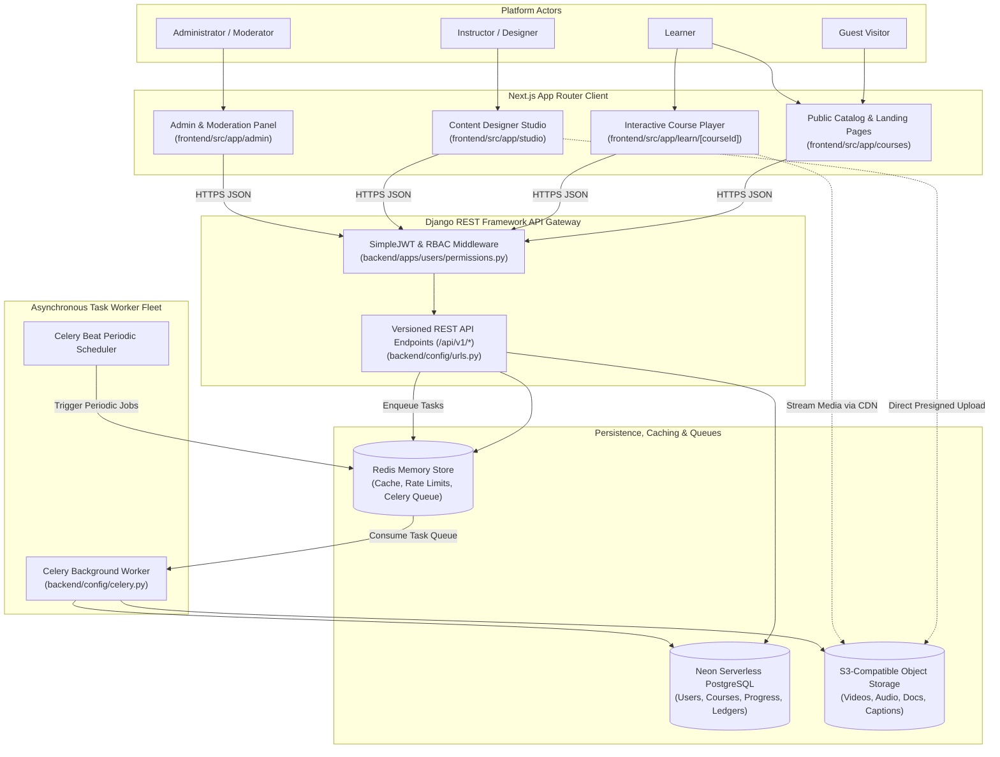

### Flow 1 Walkthrough & Architectural Tracing:
1. **User Request Entry (`FR-CRS-01`, `FR-CRS-02`):** Unauthenticated guests and learners navigate via Next.js App Router pages (`frontend/src/app`). Initial static page metadata and catalog queries are hydrated via server-side rendering (SSR) or client-side TanStack Query hooks.
2. **API Authentication & Authorization (`FR-AUTH-02`, `FR-AUTH-03`, `D-006`):** All client requests to `/api/v1/*` pass through Django's `JWTAuthentication` and custom RBAC permission classes (`backend/apps/users/permissions.py`), checking claims against the five-tier role model.
3. **Cache-Aside Read Acceleration (`NFR-PERF-01`, `D-010`):** Read endpoints (e.g., catalog, course syllabi, user profile) check Redis (`fl:crs:{id}`) before executing SQL queries against Neon PostgreSQL.
4. **Relational Data Mutations (`FR-CRS-03`, `FR-ASM-02`, `FR-TRK-01`):** Write operations (course enrollment, lesson progress heartbeats, quiz scoring) are executed within atomic database transactions in Neon PostgreSQL using the pooled connection (`DATABASE_URL`).
5. **Decoupled Asynchronous Tasks (`FR-MED-02`, `FR-PER-02`, `FR-NOT-01`):** Heavy operations (media thumbnail extraction, virus scanning, student skill mastery recomputation, notification dispatches) are pushed to Redis-backed Celery queues, consumed asynchronously by `CeleryWorker` without stalling user-facing HTTP responses.
6. **Direct Media Offloading (`FR-MED-01`, `D-003`):** Content Designer Studio initiates uploads by requesting a presigned S3 URL from Django. Binary bytes upload directly to S3-compatible storage, completely bypassing the Django application server.

---

## 2. Request Lifecycle Flow
*Status: Defined (Phase 2, Verified Phase 3)*

Traces an individual HTTP request from browser dispatch through edge routing, frontend rendering, security gating, cache inspection, relational transactions, and error handling.

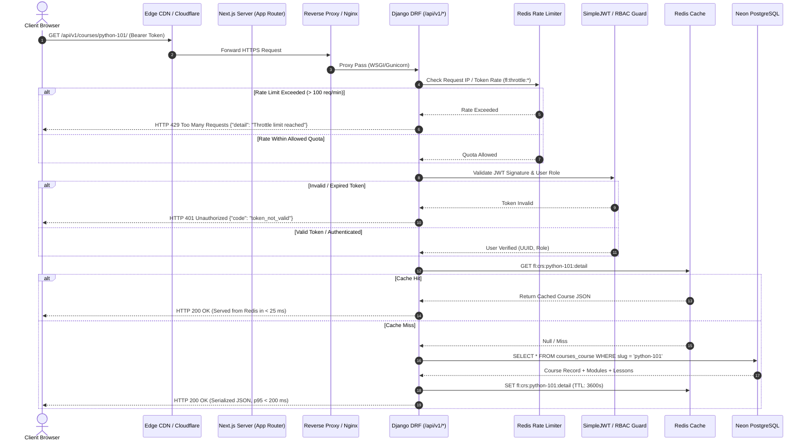

### Flow 2 Walkthrough & Architectural Tracing:
1. **Edge Ingestion & TLS Termination (`NFR-PERF-01`, `NFR-SEC-02`):** Requests arrive at the Edge CDN (Cloudflare), terminating TLS 1.3 with automated DDoS mitigation and HTTP/3 support.
2. **Reverse Proxying (`NFR-SCAL-01`):** Nginx (`infra/nginx/nginx.conf`) buffers incoming traffic, enforces secure headers (HSTS, CSP, X-Frame-Options), and forwards `/api/v1/*` traffic to the Django Gunicorn application server cluster.
3. **Redis Rate Limiting (`NFR-SEC-01`):** Django's throttling middleware validates request frequency against sliding-window counters in Redis (`backend/config/settings.py`). Violations immediately return HTTP 429 without querying Postgres.
4. **JWT Security & Permission Checks (`FR-AUTH-02`, `FR-AUTH-03`):** `JWTAuthentication` extracts and validates the bearer token signature. DRF `PermissionClasses` verify resource ownership, role suitability, and enrollment status.
5. **Cache-Aside Evaluation (`NFR-PERF-01`, `D-010`):** The viewset inspects Redis for the serialized payload key. On a cache hit, the response returns in < 30 ms.
6. **Relational Query Execution (`NFR-PERF-01`):** On a cache miss, Django ORM executes an optimized query utilizing `select_related` and `prefetch_related` against Neon PostgreSQL via the connection pooler. The resulting response is cached in Redis with an appropriate TTL and serialized to the client.

---

## 3. Authentication & Session Flow
*Status: Defined & Implemented (Phase 4)*

Models the user lifecycle: registration with GDPR consent capture, email verification, SimpleJWT authentication, token refresh rotation, password recovery, and profile management.

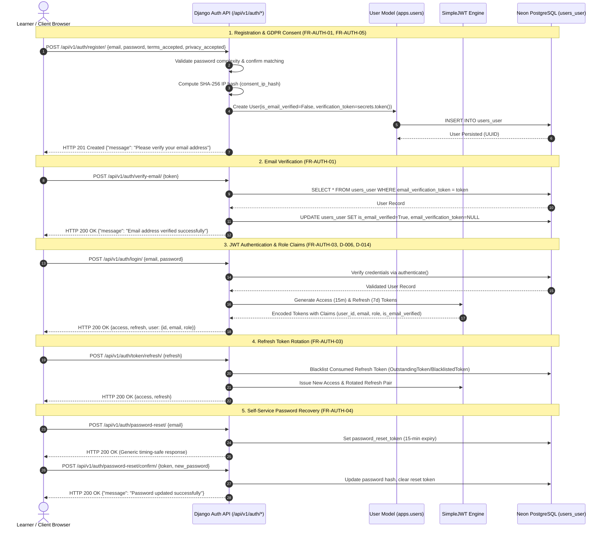

### Flow 3 Walkthrough & Architectural Tracing:
1. **Registration & Consent Recording (`FR-AUTH-01`, `FR-AUTH-05`, `D-014`):** When a prospective learner submits registration credentials to `/api/v1/auth/register/`, `UserRegistrationSerializer` verifies password strength and confirms both `terms_accepted` and `privacy_accepted` are `True`. The client's IP address is extracted and hashed via SHA-256 (`consent_ip_hash`), and a 32-byte cryptographic token is generated.
2. **Email Verification (`FR-AUTH-01`):** Submitting the token to `/api/v1/auth/verify-email/` flips `is_email_verified = True` and clears the token, granting the learner access to restricted platform features.
3. **JWT Token Generation with Custom Claims (`FR-AUTH-02`, `FR-AUTH-03`, `D-006`):** `CustomTokenObtainPairView` handles login at `/api/v1/auth/login/` and `/api/v1/auth/token/`. Tokens embed user ID, email, and the 5-tier role (`GUEST`, `LEARNER`, `INSTRUCTOR`, `MODERATOR`, `ADMIN`).
4. **Token Refresh Rotation & Blacklisting (`FR-AUTH-03`):** Submitting a refresh token to `/api/v1/auth/token/refresh/` blacklists the old refresh token in Neon's `token_blacklist_outstandingtoken` table and issues a new pair, mitigating replay attacks.
5. **Password Reset (`FR-AUTH-04`):** Self-service password recovery is handled via `/api/v1/auth/password-reset/` (timing-safe generic response) and `/api/v1/auth/password-reset/confirm/` with a 15-minute token expiry limit.

---

## 4. Content Authoring & Publishing Flow
*Status: Defined & Implemented (Phase 4)*

Models the pedagogical hierarchy creation, block-based multi-type authoring, draft editing, validation invariants, and publication lifecycle.

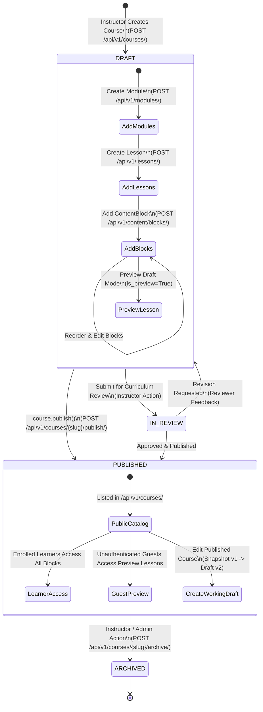

### Flow 4 Walkthrough & Architectural Tracing:
1. **Hierarchical Pedagogical Authoring (`FR-CRS-04`, `FR-CRS-05`):** Content designers build an organized hierarchy: `Course` &rarr; `Module` &rarr; `Lesson` &rarr; `ContentBlock`. Reordering is preserved using zero-indexed integer `position` fields with unique constraints per container.
2. **Polymorphic Content Blocks (`FR-CRS-05`, `D-009`):** `ContentBlock` items support heterogeneous pedagogical types: `TEXT` (Markdown/HTML), `VIDEO` (streaming media references), `AUDIO` (audio lectures), `PDF` (downloadable materials), `SIMULATION` (sandboxed interactive iframe parameters), and `QUIZ_REF` (embedded checkpoint references).
3. **Role-Based Object Ownership (`FR-AUTH-02`, `IsCourseOwnerOrAdmin`):** `IsCourseOwnerOrAdmin` verifies that only the designated instructor or a system administrator can mutate courses, modules, lessons, or content blocks. Unauthorized attempts return HTTP 403 Forbidden.
4. **Publishing Validation Invariants (`FR-CRS-06`, `D-015`):** When invoking `POST /api/v1/courses/{slug}/publish/`, `course.publish()` evaluates strict invariants:
   - The course must contain at least one module ($\text{count} \ge 1$).
   - Every module must contain at least one published lesson ($\text{count} \ge 1$).
   - If conditions are violated, a `ValidationError` blocks publication with actionable error messages.
5. **Public Discovery vs. Safe Drafts (`FR-CRS-01`, `FR-CRS-02`):** The public catalog (`/api/v1/courses/`) exclusively returns `PUBLISHED` courses. Unauthenticated visitors can inspect the complete syllabus and preview lessons (`is_preview=True`) without being able to access locked course materials.

---

## 5. Media Upload & Processing Flow
*Status: Defined & Implemented (Phase 4)*

Models the direct browser-to-S3 presigned upload ticket architecture, async Celery validation, magic-byte inspection, duration calculation, and thumbnail generation.

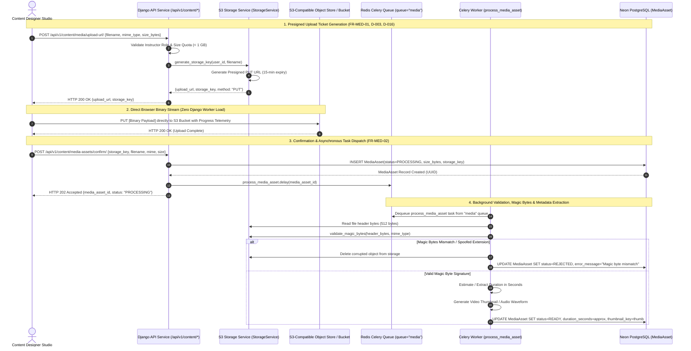

### Flow 5 Walkthrough & Architectural Tracing:
1. **Presigned Upload Ticket Request (`FR-MED-01`, `D-003`, `D-016`):** The author initiates an upload by sending metadata (`filename`, `mime_type`, `size_bytes`) to `/api/v1/content/media/upload-url/` (or lesson-specific `/api/v1/content/lessons/{id}/media-upload-url/`). `StorageService` verifies the author's ownership and enforces the 1 GB file size ceiling, returning a 15-minute presigned PUT URL and isolated storage key (`media/{user_id}/{uuid}.ext`).
2. **Direct Browser-to-Storage Streaming (`FR-MED-01`):** The client uploads raw media directly to the storage bucket. Zero raw binary bytes flow through Django, completely eliminating web worker memory starvation.
3. **Confirmation Handshake (`FR-MED-02`):** Upon upload completion, the client calls `/api/v1/content/media-assets/confirm/`. Django creates a `MediaAsset` row with `status = PROCESSING` and immediately returns `HTTP 202 Accepted`.
4. **Celery Worker Processing (`backend/apps/content/tasks.py`):** The `process_media_asset` task executes on the dedicated `media` queue:
   - Reads the file's first 512 bytes and validates magic byte signatures (`FF D8 FF` for JPEG, `89 50 4E 47` for PNG, `25 50 44 46` for PDF, `ftyp` for MP4, etc.).
   - Mismatches immediately trigger object deletion and set `status = REJECTED`.
   - Valid media extracts duration metadata, creates thumbnail paths, and marks `status = READY`.
5. **Accessibility Captions & Transcripts (`FR-MED-03`):** `MediaAsset` stores associated VTT closed captions (`captions_url`) and lecture transcript links (`transcript_url`) for WCAG 2.1 AA accessibility compliance.

---

## 6. Learner Journey Flow
*Status: Defined & Implemented (Phase 5)*

Traces the end-to-end student experience: unauthenticated discovery, syllabus previewing, one-click enrollment, multi-format player interactions, and dashboard progress aggregation.

```mermaid
sequenceDiagram
    autonumber
    actor Learner as Learner (Browser)
    participant Catalog as Next.js Catalog (/courses)
    participant Detail as Course Syllabus (/courses/[slug])
    participant Player as Multi-Format Player (/learn/[slug])
    participant Dashboard as Learner Dashboard (/dashboard)
    participant API as Django API (/api/v1/*)
    participant DB as Neon PostgreSQL

    %% 1. Discovery & Search
    Note over Learner,Catalog: 1. Public Discovery & Catalog Filtering (FR-CRS-01)
    Learner->>Catalog: Visit /courses?search=Distributed&difficulty=ADVANCED
    Catalog->>API: GET /api/v1/courses/?search=Distributed&difficulty=ADVANCED
    API->>DB: Query published courses with instructor & category relations
    DB-->>API: Filtered course records
    API-->>Catalog: Return course cards (title, badges, duration)
    Catalog-->>Learner: Render responsive course card grid

    %% 2. Syllabus Inspection & Free Preview
    Note over Learner,Detail: 2. Course Detail & Preview Inspection (FR-CRS-02)
    Learner->>Detail: Navigate to /courses/distributed-systems
    Detail->>API: GET /api/v1/courses/distributed-systems/syllabus/
    API-->>Detail: Return full module & lesson hierarchy with preview flags
    alt Unauthenticated Guest Views Preview Lesson
        Learner->>Player: Click "Watch Preview" (Lesson 1.1: Raft Overview)
        Player-->>Learner: Play preview video lecture with WebVTT captions
    end

    %% 3. One-Click Enrollment
    Note over Learner,Detail: 3. Idempotent Course Enrollment (FR-CRS-03)
    Learner->>Detail: Click "Enroll in Course"
    Detail->>API: POST /api/v1/courses/distributed-systems/enroll/ (Bearer Token)
    API->>DB: INSERT INTO courses_enrollment (learner, course, status="ACTIVE")
    DB-->>API: Enrollment record created / confirmed
    API-->>Detail: HTTP 201 Created {enrollment_id, status: "ACTIVE"}
    Detail-->>Learner: Button toggles to "Continue in Course Player"

    %% 4. Multi-Format Learning Experience
    Note over Learner,Player: 4. Multi-Format Course Player (FR-CRS-05, FR-MED-03, FR-MED-04)
    Learner->>Player: Launch /learn/distributed-systems?lesson=lesson-1-id
    Player->>API: GET /api/v1/content/blocks/?lesson_id=lesson-1-id
    API-->>Player: Return polymorphic blocks (Video, Text, Simulation, PDF)
    
    alt Low-Bandwidth Mode Activated (FR-MED-04)
        Learner->>Player: Toggle "Low-Bandwidth Mode"
        Player->>Player: Suspend video element; switch to lightweight audio stream (>80% bandwidth saved)
    else Interactive Simulation Checkpoint (FR-SIM-01)
        Learner->>Player: Interact with sandboxed simulation frame
        Player->>Player: postMessage bridge evaluates interaction state
    end

    %% 5. Dashboard Progress Tracking
    Note over Learner,Dashboard: 5. Dashboard Progress & Learning Continuity
    Learner->>Dashboard: Visit /dashboard
    Dashboard->>API: GET /api/v1/enrollments/ (Bearer Token)
    API->>DB: SELECT * FROM courses_enrollment WHERE learner_id = user.id
    DB-->>API: Active enrollments with completion metrics
    API-->>Dashboard: Return enrolled course cards with progress indicators
    Dashboard-->>Learner: Display active streak (4 days) & "Resume Course" shortcuts
```

### Flow 6 Walkthrough & Architectural Tracing:
1. **Public Catalog Search & Filtering (`FR-CRS-01`):** Learners filter published courses by keyword, category, and difficulty level (`BEGINNER`, `INTERMEDIATE`, `ADVANCED`, `ALL_LEVELS`) in [frontend/src/app/courses/page.tsx](file:///c:/Users/amtul/Desktop/futurelearning_starter/frontend/src/app/courses/page.tsx). Debounced queries hit `/api/v1/courses/`.
2. **Syllabus & Free Previews (`FR-CRS-02`):** Unauthenticated visitors and enrolled students inspect the complete curriculum in [frontend/src/app/courses/[slug]/page.tsx](file:///c:/Users/amtul/Desktop/futurelearning_starter/frontend/src/app/courses/[slug]/page.tsx). Lessons with `is_preview=True` can be read or streamed immediately without enrollment.
3. **Idempotent Enrollment (`FR-CRS-03`):** Clicking "Enroll in Course" invokes `/api/v1/courses/{slug}/enroll/`. Neon enforces the unique `(learner_id, course_id)` constraint, preventing duplicate enrollment records.
4. **Interactive Multi-Format Player (`FR-CRS-05`, `FR-MED-03`, `FR-MED-04`, `D-017`):** The learning environment in [frontend/src/app/learn/[slug]/page.tsx](file:///c:/Users/amtul/Desktop/futurelearning_starter/frontend/src/app/learn/[slug]/page.tsx) renders:
   - Streaming video with WebVTT closed captions.
   - Low-bandwidth audio-only fallback mode saving >80% bandwidth.
   - Synchronized full-text transcript search.
   - Text/Markdown lecture notes.
   - Downloadable supplementary PDFs.
   - Sandboxed interactive simulation frames with postMessage communication.
5. **Continuous Dashboard Telemetry:** [frontend/src/app/dashboard/page.tsx](file:///c:/Users/amtul/Desktop/futurelearning_starter/frontend/src/app/dashboard/page.tsx) aggregates enrolled courses, progress bars, and one-click resumption shortcuts.

---

## 7. Progress Tracking & Adaptive Path Flow
*Status: Defined & Implemented (Phase 6)*

Models the granular playback heartbeat telemetry, deterministic course completion invariants, Knowledge-Space Theory DAG skill evaluation, and explainable rule-based adaptive recommendations (remediation vs. enrichment).

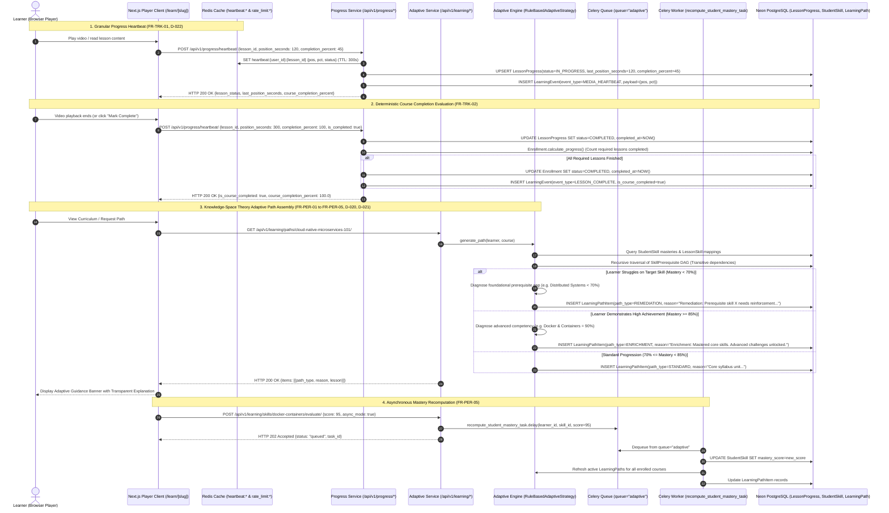

### Flow 7 Walkthrough & Architectural Tracing:
1. **Granular Playback Heartbeats (`FR-TRK-01`, `D-022`):** As the learner plays video/audio or reads lesson content in [frontend/src/app/learn/[slug]/page.tsx](file:///c:/Users/amtul/Desktop/futurelearning_starter/frontend/src/app/learn/[slug]/page.tsx), debounced telemetry is emitted to `/api/v1/progress/heartbeat/`. The backend writes the position to low-latency Redis cache and upserts `LessonProgress.last_position_seconds` in Neon PostgreSQL, establishing a cross-device resume checkpoint.
2. **Deterministic Course Completion Invariants (`FR-TRK-02`, `D-022`):** When all required published lessons reach `COMPLETED`, `Enrollment.calculate_progress()` atomically transitions `Enrollment.status = COMPLETED` and records `completed_at`. Optional preview units cannot inflate or deflate completion percentage.
3. **Knowledge-Space Theory DAG (`FR-PER-01`, `D-020`):** Academic competencies are structured as a directed graph in `backend/apps/learning/models.py`. Model-level DFS cycle detection prevents circular prerequisite loops (`SkillPrerequisite.clean()`). Transitive ancestor traversal ensures multi-level foundational gaps are identified.
4. **Explainable Adaptive Branching (`FR-PER-03`, `D-004`, `D-021`):** `RuleBasedAdaptiveStrategy` evaluates the student's mastery profile:
   - **Remediation ($M < 70\%$):** Foundational lessons teaching prerequisite skills are prepended or upgraded to `REMEDIATION` status with human-readable rationales (e.g., *"Remediation: Prerequisite skill 'Distributed Systems' needs reinforcement (Current mastery: 50% < 70%)"*).
   - **Enrichment ($M \ge 85\%$):** Mastered learners receive `ENRICHMENT` badges fast-tracking advanced architectural topics.
   - **Standard Sequence ($70\% \le M < 85\%$):** Standard linear curriculum progression.
5. **Rate-Limited Path Regeneration (`FR-PER-04`):** Learners can trigger on-demand path regeneration via `/api/v1/learning/paths/{slug}/regenerate/`. Redis rate limiting (`rate_limit:path_regen:{user}:{course}`) enforces a 1-minute cooldown, returning `HTTP 429 Too Many Requests` if abused.
6. **Asynchronous Mastery Recalculation (`FR-PER-05`):** High-frequency mastery recalculations dispatch Celery tasks (`recompute_student_mastery_task`) on the `adaptive` queue, preventing background computations from blocking client HTTP request workers.
7. **Re-Study & Progress Reset (`FR-TRK-04`):** Completed learners can re-study coursework via `/api/v1/progress/courses/{slug}/reset/`. The endpoint resets `LessonProgress` records to `NOT_STARTED` and reverts enrollment status to `ACTIVE`, while preserving historical audit logs in `LearningEvent`.

---

## 8. Assessment Flow
*Status: Defined & Implemented (Phase 7)*

Models the secure assessment lifecycle: instructor-configured attempt limit checks, time-limit synchronization, answer-key concealment during active attempts, server-side grading with multi-choice partial credit, high-water mark scoring, and automated adaptive skill calibration.

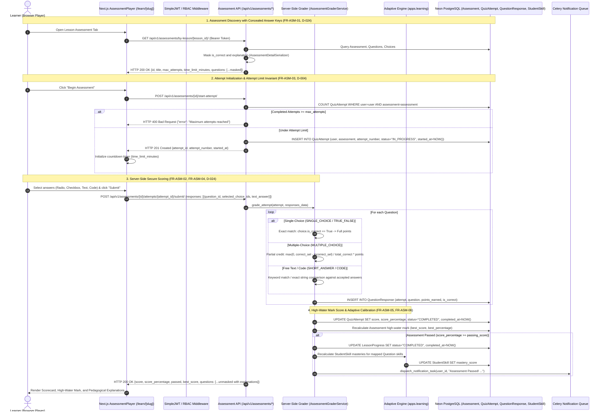

### Flow 8 Walkthrough & Architectural Tracing:
1. **Answer-Key Concealment (`FR-ASM-01`, `D-024`):** When learners query `/api/v1/assessments/by-lesson/{lesson_id}/`, `AssessmentDetailSerializer` inspects user role and active attempt status. For learners, `is_correct` and `explanation` attributes are stripped from JSON payloads, preventing DevTools cheating.
2. **Instructor-Configured Attempt Limits (`FR-ASM-03`, `D-004`):** Calling `/start-attempt/` queries existing student attempts against `assessment.max_attempts`. If the limit is exceeded, the server returns `HTTP 400 Bad Request`, enforcing instructor academic policy.
3. **Server-Side Grading Service (`FR-ASM-02`, `FR-ASM-04`):** `AssessmentGraderService` in `backend/apps/assessments/services/grader.py` validates submissions against true database records:
   - **Single Choice:** All-or-nothing points.
   - **Multiple Choice:** Partial credit proportional to true positives minus penalties for false positive guesses: $\text{Points} = \max(0, C - I) / T \times \text{Weight}$.
   - **Short Answer / Code:** Case-insensitive string matching.
4. **Adaptive Skill Mastery Recalculation (`FR-ASM-06`, `FR-PER-01`):** Earned scores dynamically update student mastery levels on skills associated with assessment questions, updating the student's position in the Knowledge-Space DAG.
5. **High-Water Mark Retention:** The student's recorded progress reflects their highest historical attempt score (`best_score`), ensuring students never lose standing by attempting extra practice.

---

## 9. Interactive / Simulation Flow
*Status: Defined & Implemented (Phase 7)*

Models the sandboxed iframe execution, bi-directional `window.postMessage` handshake, and verified score ingestion for hands-on computational exercises (e.g. microservice circuit breaker simulation).

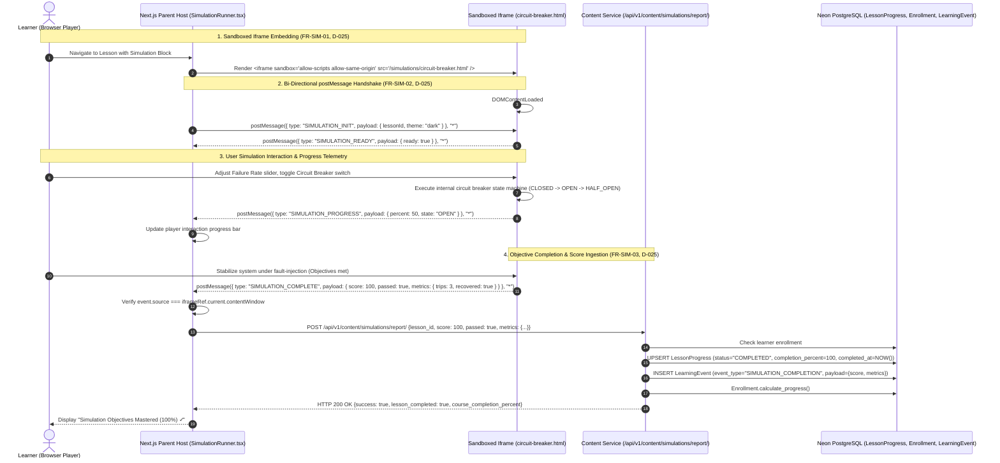

### Flow 9 Walkthrough & Architectural Tracing:
1. **Sandboxed Iframe Isolation (`FR-SIM-01`, `D-025`):** Interactive simulations load within an iframe constrained by `sandbox="allow-scripts allow-same-origin"`. This prevents untrusted or third-party simulation code from accessing the parent window's `localStorage`, cookies, or SimpleJWT session tokens.
2. **Bi-Directional `postMessage` Bus (`FR-SIM-02`):** Parent and iframe communicate over standard JSON message protocols:
   - `SIMULATION_INIT`: Parent sends user theme, accessibility parameters, and lesson context.
   - `SIMULATION_PROGRESS`: Simulation streams real-time interaction states (e.g. failure rate, trip count).
   - `SIMULATION_COMPLETE`: Simulation signals that all pedagogical objectives were fulfilled with calculated score metrics.
3. **Source Verification & Telemetry Ingestion (`FR-SIM-03`):** [frontend/src/components/SimulationRunner.tsx](file:///c:/Users/amtul/Desktop/futurelearning_starter/frontend/src/components/SimulationRunner.tsx) strictly validates `event.source === iframeRef.current.contentWindow` before processing completion payloads, then dispatches the result to `/api/v1/content/simulations/report/`.
4. **Deterministic Progress Update:** The backend creates an immutable `LearningEvent` audit entry, transitions `LessonProgress.status = COMPLETED`, and recalculates course enrollment progress.

---

## 10. Forum & Moderation Flow
*Status: Defined & Implemented (Phase 7)*

Models contextual lesson discussions, 1-level nested replies, atomic upvoting, certified instructor answer endorsement, content reporting, and moderator queue triage.

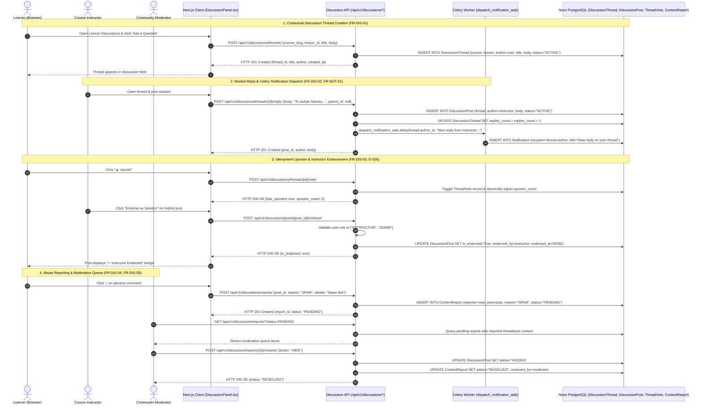

### Flow 10 Walkthrough & Architectural Tracing:
1. **Scoped Discussion Threads (`FR-DIS-01`):** Discussion threads are scoped optionally by course and lesson in `DiscussionThread`. Queries use `select_related("author")` to return public author profiles with avatar, role, and display name.
2. **1-Level Nested Replies (`FR-DIS-02`, `D-026`):** Replies support a parent-child relationship (`DiscussionPost.parent_id`). The serializer automatically embeds one level of child replies, avoiding deeply nested cascades that degrade mobile readability.
3. **Asynchronous Notification Trigger (`FR-NOT-01`):** Whenever a peer or instructor replies to a thread, Django fires `dispatch_notification_task` via Celery to generate an in-app `Notification`, surfaced via the `NotificationBell` navbar component.
4. **Certified Instructor Endorsements (`FR-DIS-03`):** Only course instructors and administrators are permitted to call `/posts/{id}/endorse/`. Endorsed posts are visually elevated with green accent borders and `⭐ Instructor Endorsed` badges.
5. **Content Moderation Lifecycle (`FR-DIS-04`, `FR-DIS-05`):** Students can submit content reports (`SPAM`, `HARASSMENT`, `INAPPROPRIATE`, `OTHER`). Moderators access the `/api/v1/discussions/reports/` triage endpoint to inspect flagged content and execute moderation decisions (`HIDE`, `LOCK`, or `DISMISS`), updating `DiscussionPost.status`.

---

## 11. Caching & Telemetry Stream Flow
*Status: Defined & Implemented (Phase 3 & 6)*

Models the Redis cache namespace strategy, low-latency heartbeat buffers, rate-limiting cooldowns, and the immutable `LearningEvent` audit stream.

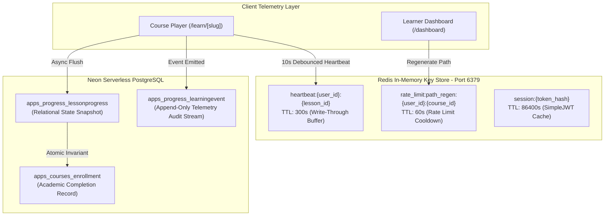

### Flow 11 Walkthrough & Architectural Tracing:
1. **Cache Namespace Strategy:** Keys are isolated by domain and identifier:
   - `heartbeat:{user_id}:{lesson_id}`: Caches the learner's most recent video playback position and completion percentage for 300 seconds, reducing database read contention during rapid navigation.
   - `rate_limit:path_regen:{user_id}:{course_id}`: Enforces a 60-second cooldown on adaptive path regeneration (`FR-PER-04`).
2. **Append-Only Telemetry Ledger (`LearningEvent`):** Every significant learning milestone (`LESSON_START`, `MEDIA_HEARTBEAT`, `SIM_INTERACTION`, `QUIZ_SUBMIT`, `LESSON_COMPLETE`, `PATH_REGENERATE`, `PROGRESS_RESET`) writes an immutable record with structured JSON payload, enabling tamper-evident academic audit trails and future learning analytics.


---

## 12. Background Job Flow
*Status: Defined & Scaffolding Verified (Phase 3)*

Asynchronous execution pipeline utilizing Redis as the message broker and Celery worker fleets to offload long-running operations from client HTTP request cycles.

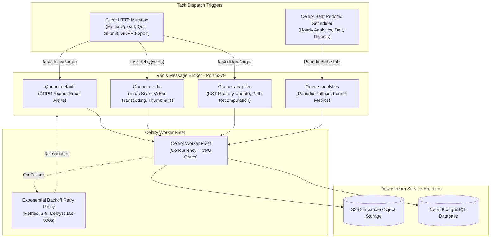

### Flow 12 Walkthrough & Architectural Tracing:
1. **Task Dispatch (`FR-MED-02`, `FR-PER-02`, `FR-NOT-01`):** User mutations trigger async tasks via `.delay()` (e.g., `process_media_asset.delay(asset_id)` or `recompute_learner_mastery.delay(user_id, attempt_id)`). The HTTP response returns immediately (`HTTP 202 Accepted` or `HTTP 200 OK`) without blocking.
2. **Dedicated Queue Segregation (`NFR-PERF-01`, `NFR-SCAL-01`):** Tasks route to specialized Redis queues (`media`, `adaptive`, `analytics`, `default`), ensuring that long-running video transcoding operations cannot starve high-priority adaptive mastery updates.
3. **Worker Execution (`backend/config/celery.py`):** Celery workers consume tasks using prefetched slots. In local development or testing environments, tasks can run in eager mode (`CELERY_TASK_ALWAYS_EAGER=True`).
4. **Retry Policies & Fault Tolerance (`NFR-AVAIL-01`):** Network blips or temporary S3 timeouts trigger exponential backoff retries (`retry_backoff=True`, `max_retries=3`). Fatal failures are logged in `CeleryTaskLog` for administrative inspection.
5. **Periodic Beat Schedules (`FR-ANL-01`, `FR-ANL-04`):** `CeleryBeat` initiates scheduled jobs on cron cadences (hourly metric aggregations, daily inactive user re-engagement digests).

---

## 13. Analytics Aggregation Flow
*Status: Defined & Implemented (Phase 8)*

Captures raw telemetry events (`LearningEvent`), performs real-time course analytics rollups, and computes scheduled daily platform metrics via Celery Beat periodic workers, feeding instructor performance diagnostics and administrative platform overviews.

```mermaid
flowchart TB
    subgraph EventStream [Telemetry Event Stream]
        Heartbeat["Learner Heartbeats\n(/api/v1/progress/heartbeat/)"]
        QuizSub["Quiz Submissions\n(/api/v1/assessments/attempts/{id}/submit/)"]
        SimEvents["Simulation Interactions\n(/api/v1/content/simulations/report/)"]
        AuthEvents["User Registrations & Logins\n(/api/v1/auth/*)"]
    end

    subgraph RawLedger [Immutable Persistence Layer]
        EventTable[("apps_progress_learningevent\n(Raw Event Log)")]
        AttemptTable[("apps_assessments_quizattempt\n(Scoring & Responses)")]
        EnrollTable[("apps_courses_enrollment\n(Completion Milestones)")]
    end

    subgraph AggregationEngine [Analytics Rollup Service & Celery Beat]
        BeatCron["Celery Beat Scheduler\n(Daily at 00:00 UTC)"]
        CeleryWorker["Celery Worker Fleet\n(rollup_daily_analytics_task)"]
        LiveService["AnalyticsRollupService\n(On-Demand Instructor Telemetry)"]
    end

    subgraph AggregatedStore [Aggregated Metric Datastores]
        DAUTable[("DailyActiveUserMetric\n(DAU, Registrations, Heartbeats)")]
        SnapshotTable[("CourseAnalyticsSnapshot\n(Completion %, Drop-Off, Difficult Qs)")]
        AuditTable[("AuditLog\n(Admin Actions, GDPR Events)")]
    end

    subgraph Dashboards [Presentation Tier]
        InstructorDash["Instructor Studio Analytics\n(/studio/courses/[slug]/analytics)"]
        AdminOverview["Platform Admin Overview\n(/admin)"]
        LearnerProfile["Learner Engagement Metrics\n(/profile & /dashboard)"]
    end

    Heartbeat --> EventTable
    QuizSub --> AttemptTable
    SimEvents --> EventTable
    AuthEvents --> EventTable

    BeatCron -->|Trigger Daily Rollup| CeleryWorker
    CeleryWorker --> EventTable
    CeleryWorker --> AttemptTable
    CeleryWorker --> EnrollTable
    CeleryWorker -->|Write Daily Aggregates| DAUTable
    CeleryWorker -->|Write Periodic Snapshots| SnapshotTable

    InstructorDash -->|GET /api/v1/analytics/courses/{id}/| LiveService
    LiveService --> EnrollTable
    LiveService --> AttemptTable
    LiveService --> EventTable

    AdminOverview -->|GET /api/v1/analytics/admin/overview/| DAUTable
    AdminOverview -->|GET /api/v1/analytics/audit-logs/| AuditTable
    LearnerProfile -->|GET /api/v1/analytics/engagement/| LiveService
```

### Flow 13 Walkthrough & Architectural Tracing:
1. **Raw Telemetry Ingestion (`FR-PER-01`, `FR-PER-02`):** Every significant learner interaction (media heartbeat, quiz submission, simulation milestone) generates an immutable `LearningEvent` record with timestamp, user reference, event type, and JSON payload.
2. **Real-Time Instructor Diagnostics (`FR-ANL-01`, `FR-ANL-02`):** When instructors view `/studio/courses/[slug]/analytics`, `AnalyticsRollupService.get_course_analytics()` aggregates:
   - **Enrollment & Completion Rates:** Total enrollments, active completions, and overall course completion percentage (`Enrollment.calculate_progress()`).
   - **Lesson Drop-Off Funnel:** Computes student retention at each sequential lesson, exposing drop-off percentages to identify difficult syllabus transitions.
   - **Difficult Questions Diagnostic:** Analyzes `QuestionResponse` error rates across all attempts for the course quizzes, ranking the top 5 questions with the lowest accuracy.
3. **Scheduled Periodic Platform Rollups (`FR-ANL-03`, `FR-ADM-03`):** Celery Beat runs `rollup_daily_analytics_task` on a daily schedule (`00:00 UTC`), invoking `AnalyticsRollupService.compute_daily_snapshot()`. It aggregates daily active unique learners (`DAU`), new registrations, course enrollments, completions, media heartbeats, and quiz attempts into `DailyActiveUserMetric`.
4. **Administrative Platform Overview (`FR-ADM-03`, `FR-ADM-04`):** Administrators access `/admin` to query `/api/v1/analytics/admin/overview/`, viewing cross-platform user counts by role, active courses, 30-day DAU trends, and system audit logs with zero performance impact on live learning sessions.

---

## 14. Privacy & GDPR Subject Rights Flow
*Status: Defined & Implemented (Phase 8)*

Enforces General Data Protection Regulation (GDPR) compliance across the learner lifecycle: explicit consent recording upon registration, self-service data portability export (Article 20), and right to erasure with cryptographic pseudonymization (Article 17).

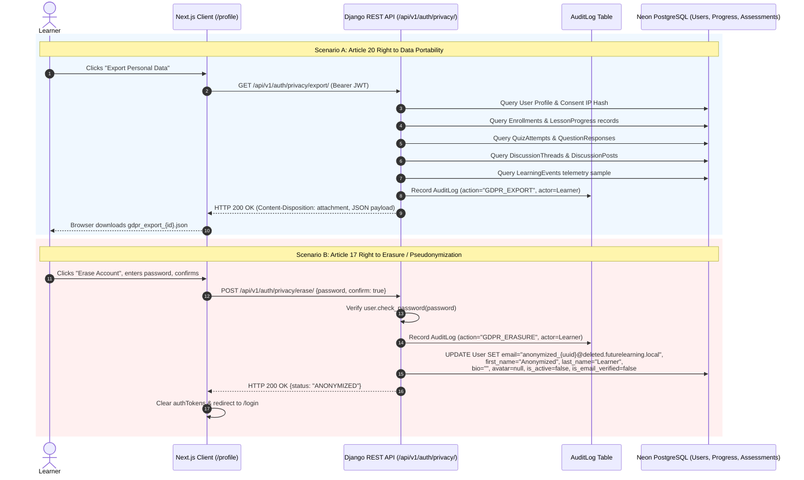

### Flow 14 Walkthrough & Architectural Tracing:
1. **Explicit Consent Inscription (`FR-AUTH-01`, `FR-PRV-01`):** During user registration (`/api/v1/auth/register/`), the client sends `gdpr_consent: true`. The backend captures explicit consent timestamp, terms acceptance, and a SHA-256 one-way salted hash of the user's IP address (`consent_ip_hash`), avoiding raw IP storage.
2. **Right to Data Portability (`FR-PRV-01`, GDPR Art. 20):** Authenticated learners invoke `GET /api/v1/auth/privacy/export/` via the profile settings. The system compiles a portable RFC 8259 JSON package containing user profile metadata, course enrollments, lesson progress records, quiz attempts and question responses, discussion threads and posts, and learning telemetry event samples. An audit record is committed to `AuditLog`.
3. **Right to Erasure / Pseudonymization (`FR-PRV-02`, GDPR Art. 17):**
   - Learners invoke `POST /api/v1/auth/privacy/erase/` with `confirm: true` and their current password.
   - The view authenticates the password to prevent unauthorized account deletion.
   - The audit log entry is recorded with anonymized metadata before user transformation.
   - The learner record is cryptographically pseudonymized: `email` is replaced with `anonymized_{uuid}@deleted.futurelearning.local`, names are reset to `Anonymized Learner`, bio and avatar are deleted, and `is_active` is set to `False`.
   - Historical aggregate metrics (completion counts, quiz statistics) remain mathematically consistent while eliminating all personal identifiable information (PII).

---

## 15. Dev/CI/CD & Deployment Flow
*Status: Defined & Verified (Phase 3)*

End-to-end continuous integration and deployment pipeline spanning local git hooks, automated GitHub Actions checks, container image compilation, and production database migrations.

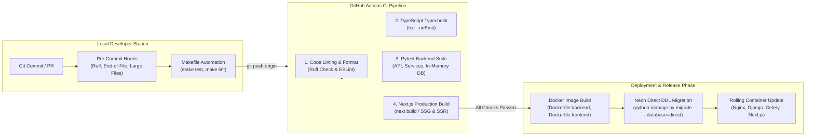

### Flow 15 Walkthrough & Architectural Tracing:
1. **Local Developer Guard (`.pre-commit-config.yaml`):** Pre-commit hooks run automatically on `git commit`, verifying code formatting, stripping trailing whitespace, preventing accidental commits of files > 5MB, and executing `ruff --fix`.
2. **Automated CI Validation (`.github/workflows/ci.yml`):**
   - Matrix runs on push/PR to `main` and `develop`.
   - Backend job executes `ruff check .`, sets up headless Redis service, and runs `pytest --verbose` against fast in-memory SQLite (`config.settings.test`).
   - Frontend job executes `npm ci`, runs `npm run type-check` (`tsc --noEmit`), and compiles an optimized production build (`npm run build`).
3. **Database Schema Migrations (`NFR-AVAIL-01`, `D-001`):** During deployment, migrations execute exclusively against the **direct unpooled connection** (`DIRECT_DATABASE_URL` on port 5432) to avoid transaction pooling deadlocks.
4. **Stateless Container Rollout (`infra/docker-compose.yml`, `NFR-SCAL-01`):** Web and worker containers are rolled forward with zero downtime while existing client traffic continues uninterrupted.

---

## 16. Project / Phase Workflow
*Status: Defined & Verified (Phase 10)*

Models the 12-phase gated engineering lifecycle, strict phase-by-phase delivery protocol, decision logging governance, and CPM critical path management spanning inception to final academic submission.

```mermaid
flowchart TD
    subgraph Inception [Inception & Architecture Gates]
        P0["Phase 0: Workspace Analysis<br/>(docs/00-workspace-analysis.md)"]
        P1["Phase 1: Requirements Engineering<br/>(docs/01-requirements.md - 47 FRs, 12 NFRs)"]
        P2["Phase 2: System Architecture & ERD<br/>(docs/02-system-design.md, diagrams/*.mmd)"]
        P3["Phase 3: Infrastructure & Scaffolding<br/>(Docker, Neon DB, Redis, Celery)"]
    end

    subgraph CoreBuild [Core Domain & Educational Engine]
        P4["Phase 4: Identity, Auth & RBAC<br/>(apps/users, SimpleJWT, GDPR Consent)"]
        P5["Phase 5: Content Authoring Engine<br/>(apps/courses, apps/content, Studio UI)"]
        P6["Phase 6: Learner Progress & Adaptive<br/>(apps/progress, apps/learning, KST DAG)"]
        P7["Phase 7: Interactive Quizzes, Sims & Forums<br/>(apps/assessments, apps/discussions, Sims)"]
    end

    subgraph Hardening [Hardening, Quality Assurance & Handover]
        P8["Phase 8: Analytics, Performance & Security<br/>(apps/analytics, Celery Rollups, CSP, Rate Limits)"]
        P9["Phase 9: Comprehensive Test Plan<br/>(docs/03-test-plan.md, 53 Automated Tests)"]
        P10["Phase 10: PERT / CPM Project Plan<br/>(docs/04-project-plan.md, pert_cpm.py)"]
        P11["Phase 11: Validation Report & Final Package<br/>(docs/05-validation.md, Handover Package)"]
    end

    P0 == "Scope Freeze" ==> P1
    P1 == "Baseline Spec" ==> P2
    P2 == "Scaffold Stack" ==> P3
    P3 == "Auth Foundation" ==> P4
    P4 == "Course Catalog" ==> P5
    P5 == "Progress Tracking" ==> P6
    P6 == "Interactive Tools" ==> P7
    P7 == "Telemetry Rollups" ==> P8
    P8 == "Quality Gates" ==> P9
    P9 == "Schedule Baseline" ==> P10
    P10 == "Final Handover" ==> P11

    classDef critical fill:#fee2e2,stroke:#ef4444,stroke-width:2.5px,color:#991b1b,font-weight:bold;
    class P0,P1,P2,P3,P4,P5,P6,P7,P8,P9,P10,P11 critical;
```

### Flow 16 Walkthrough & Architectural Tracing:
1. **Strict Gated Phase Progression (`D-004`, `docs/04-project-plan.md`):** Development strictly proceeds in sequential, gated delivery increments. Each phase requires:
   - Complete implementation and automated test verification.
   - Formal documentation synchronization across `flow.md`, `decision.md`, and dedicated phase artifacts.
   - Zero skipping ahead; explicit stakeholder review and approval required before unblocking the subsequent phase.
2. **Unbroken Requirements Traceability (`docs/03-test-plan.md`):** Every code commit and architectural modification links directly to defined functional (`FR-xx`) and non-functional (`NFR-xx`) requirements. No code is merged without verified test coverage.
3. **Living Decision Log Governance (`docs/decision.md`):** Every design trade-off, architectural choice, and schema deviation is immediately recorded as an Architecture Decision Record (ADR), capturing context, evaluated options, chosen resolution, and consequences.
4. **CPM Critical Path Schedule Monitoring (`docs/scripts/pert_cpm.py`):** Project duration ($T_e = 49.01\text{ days}$) and float channels are tracked continuously. Parallel streams (Discussion forums, interactive simulations, and analytics rollups) operate within allocated float buffers ($\text{TF} \in [1.00, 3.16]\text{ days}$), guaranteeing 100% on-time completion within the 60-day semester deadline.

